<div align="center">

  |[ **English** ]|[ [ไทย](./README.th.md) ]|
  
</div>

<p align="center">
  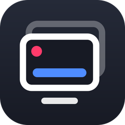
</p>

<h1 align="center">SlideMang</h1>

<p align="center">
  Slide presentation and title bar tool for streamers / VTubers.<br>
  Easy to switch media, background, and insert title bars in real-time while streaming.<br>
  <i>โปรแกรมสไลด์และไตเติลสำหรับสตรีมเมอร์ / วีทูปเบอร์ สลับภาพ วิดีโอ พื้นหลัง และขึ้นแถบข้อความได้แบบเรียลไทม์</i>
</p>

<p align="center">
  <a href="https://youtube.com/live/rJrsDisMuC0" target="_blank">
    
  </a>
</p>

---

## Table of Contents

- [What SlideMang Can Do](#what-slidemang-can-do)
- [Workflow Overview](#workflow-overview)
- [Getting Started](#getting-started)
- [Important: Media and Videos Must Be Inside the Media Folder](#important-media-and-videos-must-be-inside-the-media-folder)
- [Main Window (Launcher)](#main-window-launcher)
- [OBS Setup](#obs-setup)
- [Network Control (Mobile / Another Device)](#network-control-mobile--another-device)
- [Setup Media: Pre-stream Configuration](#setup-media-pre-stream-configuration)
- [Controller: Live Control](#controller-live-control)
- [Keyboard Shortcuts](#keyboard-shortcuts)
- [Saving and Loading Data (save.json / media-config.js)](#saving-and-loading-data-savejson--media-configjs)
- [Troubleshooting](#troubleshooting)
- [💖 Support the Project](#-support-the-project)
- [License](#license)

---

## What SlideMang Can Do

- **Switch images and videos** on stream using PREV / NEXT buttons, Quick Panel cards, or keyboard shortcuts, complete with transition effects (Cut, Fade, 4-directional Slide, Random).
- **Insert Title Bars** with 30 built-in designs, live text editing (HTML supported), or pick from prepared presets.
- **Backgrounds** separated into an independent layer using static images or looping videos.
- **Auto Slide** automatically changes images based on a set timer.
- **Transparent Display Windows** split into 3 separate windows (Titlebar / Slides / Background) ready for OBS Window Capture.
- **Network Control** open the Controller from a mobile phone or another device on the same local network, with OBS Browser Source as an alternative to Window Capture.
- Configure media lists and title bars easily via the **Setup Media** screen without touching any code.

---

## Workflow Overview

The program consists of 5 windows that can be opened and closed from the main Launcher window.

| Window | Function |
|---|---|
| **Controller** | Live control panel (switch images, trigger Title Bars, etc.) |
| **Setup Media** | Configure images, videos, backgrounds, and Title Bar presets before streaming |
| **OBS Titlebar** | Title bar display window (for OBS capture) |
| **OBS Slides** | Media/video display window (for OBS capture) |
| **OBS Background** | Background display window (for OBS capture) |

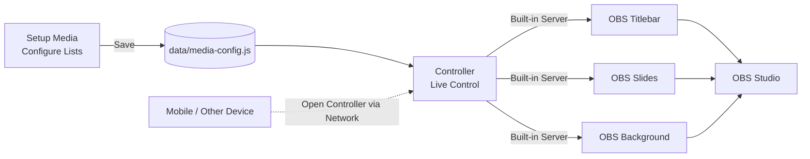

---

## Getting Started

### Method 1: Using the Executable File (.exe)

1. Download the `.exe` file from the **Releases** page of this repository.
2. Place the file in your desired directory (recommended to use an empty, writable folder like `D:\SlideMang\`; do not place it inside `Program Files`).
3. Double-click to run. On first launch, the program will automatically create `data` and `media` folders next to the executable.

> Windows may show a SmartScreen warning ("Windows protected your PC") because the program is not digitally signed. Click **More info → Run anyway** if you downloaded it from this repository.

### Method 2: Running from Source Code

1. Install [Node.js](https://nodejs.org) **version 22 LTS or higher** (older versions may fail to install Electron).
2. Open Command Prompt inside the project folder (the `APP` folder containing `package.json`) and run:

```bash
npm install
npm start
```

3. If you want to build your own `.exe` file:

```bash
npm run dist
```

> If your folder path contains non-English characters and `npm run dist` fails, move the project to a path with English characters only.

### Folder Structure

```text
SlideMang/
├── SlideMang.exe            ← Application
├── media/                   ← Place all images and videos here
│   ├── 01.jpg
│   ├── 03.mp4
│   └── ...
└── data/                    ← Configuration files
    ├── media-config.js      ← Media / Title Bar list (from Setup Media)
    ├── save.json            ← Controller state
    └── settings.json        ← Window / Server settings (managed automatically)
```

You can click **Open media folder** and **Open data folder** directly from the main launcher.

---

## Important: Media and Videos Must Be Inside the Media Folder

⚠️ **The program will only display files located inside the `media` folder.**

The reason is that the configuration file only stores the **"file name"** (e.g., `01.jpg`), not the full drive path, and it does not copy files automatically. The 📁 button next to the filename input in Setup Media simply opens a file picker and extracts the **"file name"** into the field. If you select a file from another folder (like Desktop or Downloads), its name will show in the list, but during playback, the program won't be able to find it, and the image won't appear.

### Correct Procedure

1. **Copy all image/video files** you intend to use into the `media` folder first (click **Open media folder** in the main launcher).
2. Open **Setup Media**, click the 📁 button to select files **from inside the `media` folder**, or type the file name manually.
3. Save, then reopen the Controller / display windows (see [Saving and Loading Data](#saving-and-loading-data-savejson--media-configjs)).

| Scenario | Result |
|---|---|
| File is in `media/` and selected correctly | ✅ Displays normally |
| Selected file from elsewhere (e.g., `D:\Pictures\a.jpg`) without copying to `media/` | ❌ Does not display |
| Filename in the field does not match the actual file (spelling or extension error) | ❌ Does not display |

### Tips

- **File Types:** Images (`jpg`, `png`, `gif`, `webp`, etc.) and videos (`mp4`, `webm`, `mov`, `m4v`, `ogv`). If set to "Auto", the program determines the type from the file extension.
- **Video Thumbnails** must also be files located in the `media` folder (e.g., a captured screenshot).
- **Title Bar background images** and **Quick Backgrounds (BG 1–3)** must also reside in `media`.
- Avoid special characters like `#`, `?`, `%` in filenames as they hold special meanings in web paths. Thai characters and spaces are supported.
- If you organize files into subfolders inside `media`, type the path including the subfolder in the field, e.g., `intro/01.jpg` (the 📁 button only inputs the filename).
- If moving to another computer, remember to bring the entire `media` folder along.

---

## Main Window (Launcher)

<p align="center">
  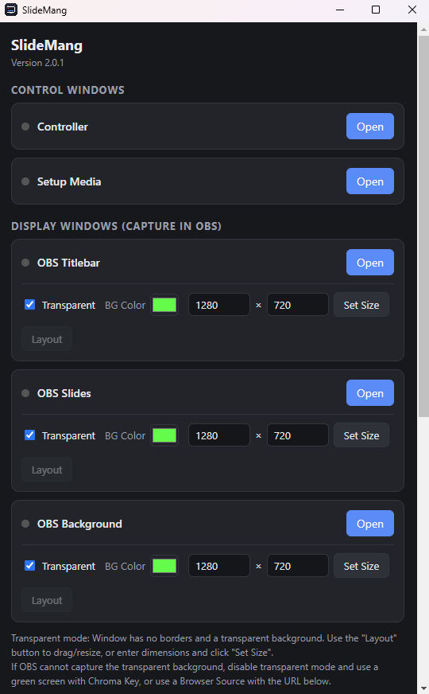
</p>

When you open the application, this window appears. Use it to open/close all other windows.

### Control Windows

Click the **Open / Close** button next to **Controller** and **Setup Media**. A green dot indicates the window is currently active.

### Display Windows (For OBS Capture)

Each window for **OBS Titlebar**, **OBS Slides**, and **OBS Background** has the following options:

| Option | Description |
|---|---|
| **Transparent** | Checked = Window has no borders and a transparent background, ideal for OBS overlay. Unchecked = Standard window (can be dragged and resized). |
| **Background Color** | Used when transparency is disabled, e.g., setting it to green for Chroma Keying in OBS. |
| **Width × Height** + **Set Size** | Sets window dimensions in pixels. Should match your OBS Canvas size (e.g., 1920×1080). |
| **Layout Mode** | Opens "Layout Mode" showing a pink dashed border, a top dragging bar, and a bottom-right corner for resizing. Useful for transparent windows with no borders to grab. (Turn this off before streaming!) |

> Transparent windows cannot be resized by dragging borders normally; use layout mode or enter dimensions and click **Set Size**.
> Toggling the "Transparent" switch while a window is open will automatically close and reopen it.

### Startup Option

The option **Automatically reopen windows that were left open** will restore previously open windows upon the next launch.

---

## OBS Setup

There are two methods available. Choose **only one method**—do not use both simultaneously, or the images will overlap.

### Method A: Window Capture

1. Open **OBS Titlebar**, **OBS Slides**, and **OBS Background** from the launcher and match their sizes to your OBS Canvas.
2. In OBS, click **+** under Sources → **Window Capture**.
3. Select the window from the **Window** dropdown ending with `OBS Background`, `OBS Slides`, and `OBS Titlebar` respectively (one source at a time).
4. Set **Capture Method** to **Windows 10 (1903 and up)** and uncheck **Capture Cursor** if you don't want the mouse to show.
5. **Arrange Source Order** from bottom to top: `Background` (bottom) → `Slides` → `Titlebar` (top).

**Audio from Videos:** In OBS, add an **Application Audio Capture** source and select this application's window. Since slides and background audio come from the same program, adjust or mute each section from the Controller (see the 🔊 bar in Media Control and Video Controller for Background).

**If a transparent background appears black:**
- Try changing the Capture Method in OBS.
- Or disable "Transparent" in the launcher, set the background color to green, and use an OBS **Chroma Key** filter.
- Or use Method B.

### Method B: Browser Source (Using URLs)

1. Check the URL under the **Server** section in the launcher and click **Copy** next to Titlebar / Slides / Background (use the `127.0.0.1` address).
2. In OBS, click **+** → **Browser**, paste the URL, and set the width and height to match your canvas.
3. The advantage is guaranteed transparency without needing to keep the program's display windows open (you can close OBS Titlebar / Slides / Background in the launcher), though the program and Controller must remain running.
4. Browser source audio is controlled via the **Control audio via OBS** option in the source's properties.

---

## Network Control (Mobile / Another Device)

<p align="center">
  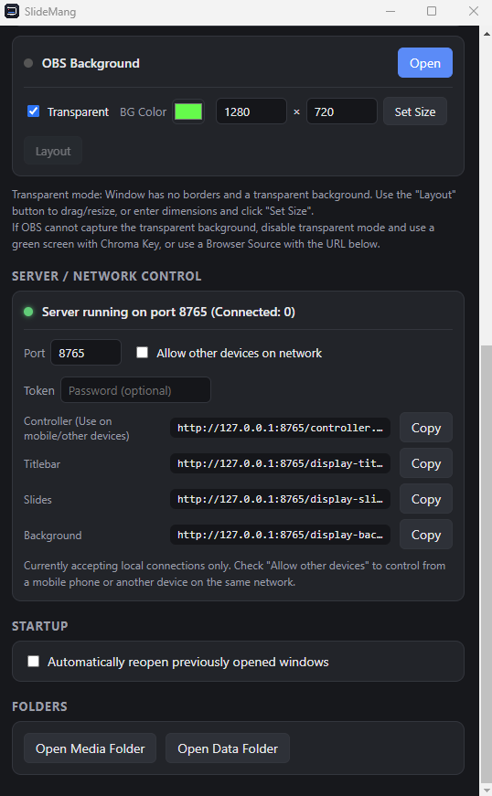
</p>

The program features a built-in server. Since windows communicate through it, you can open the **Controller** from a mobile phone, tablet, or another computer on the same local network (e.g., the same Wi-Fi).

| Option | Description |
|---|---|
| **Port** | Default is `8765`. If the port is in use, the program will try the next available port automatically (check the actual port in the status bar above this section). |
| **Allow other devices on network** | Unchecked = Local device only. Checked = Other devices can access via your machine's IP address (restarts the server automatically upon toggling). |
| **Password** | If set, other devices must enter this password. The host machine running the program bypasses this. |
| **Copy Buttons** | Copies the URL for each page (Controller / Titlebar / Slides / Background). |

### How to Use from a Mobile Device

1. Check **Allow other devices on network** and **Set a password**.
2. Click **Copy** on the **Controller** row showing the `192.168.x.x` address (your machine's IP address with the password appended).
3. Send that URL to your mobile device (e.g., via chat) and open it in a browser. The browser will remember the password for subsequent visits.
4. Both the mobile device and computer must be on the same network.

### Security Precautions

- Connections use unencrypted `http`. Only use this on trusted local networks (like home Wi-Fi). **Do not expose the port to the public internet.**
- Set a strong password, avoiding simple ones like `123`.
- The first time external access is enabled, Windows may prompt a **Firewall** alert. Click **Allow access** if you want to use this feature (choose Private networks).

---

## Setup Media: Pre-stream Configuration

Open via the **Setup Media** button in the launcher. Used to configure lists of images, videos, backgrounds, and title bar presets displayed in the controller. The left side features a 4-page menu and 3 save/load buttons.

> Before starting: **You must place your files inside the `media` folder first** (see [Important Section Above](#important-media-and-videos-must-be-inside-the-media-folder)).

### Left-side Buttons

| Button | Action |
|---|---|
| 💾 **Overwrite media-config.js** | Saves all configurations to `media-config.js`. Select the `media-config.js` file inside the `data` folder to overwrite it. |
| 📂 **Load old media-config.js** | Loads an existing `media-config.js` file for editing (useful for migrating settings from another machine or recovering from a backup). |
| 🔄 **Reset to Default** | Clears modifications and restores default settings. |

### 1) General & Quick Backgrounds

<p align="center">
  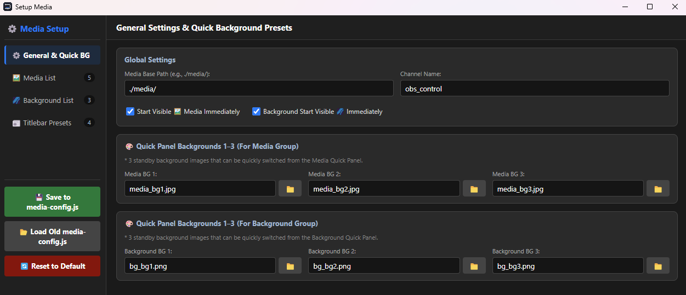
</p>

| Field | Description |
|---|---|
| **Media Base Path** | Directory storing files, default `./media/`. Keep as is generally. |
| **Channel Name** | Communication channel name used by windows, default `obs_control`. Generally doesn't need changing. |
| **Start Displaying Media / Background Immediately** | Checked = Opens display windows with media/background active right away. Unchecked = Waits for Show command in Controller. |
| **Quick Backgrounds (BG 1–3)** | 3 preset images switchable via BG 1 / BG 2 / BG 3 buttons in the Quick Panel, split into Media and Background sets (files must be in `media/`). |

### 2) Media List

<p align="center">
  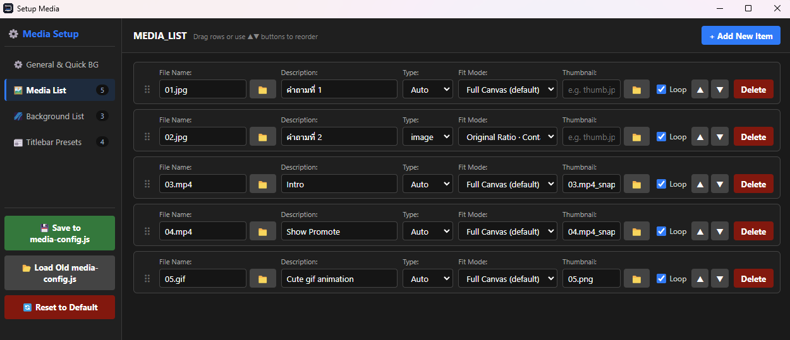
</p>

Each entry represents a card in the Controller's Quick Panel. Click **+ Add New Item** to add, drag rows (⋮⋮ icon) or click ▲▼ to reorder, and click **Delete** to remove.

| Field | Description |
|---|---|
| **Filename** | File name inside `media/` (the 📁 button helps pick names from files **already inside the media folder**) |
| **Description** | Text displayed on the Controller card (if left blank when selecting a file, the filename is used automatically) |
| **Type** | `Auto` (inferred from extension), `image`, or `video` if the program guesses incorrectly |
| **Image Fit Mode** | How the image fits the screen: **Fit Canvas** (default), **Actual Size**, **Keep Ratio · Fit Edge** (preserves aspect ratio, fully visible), **Keep Ratio · Fill Screen** (preserves aspect ratio, fills screen). Test results on the display window. |
| **Thumbnail** | Thumbnail image on the card for videos lacking built-in previews. File must be in `media/`. |
| **Loop** | Checked = Video loops (default). Unchecked = Plays once. |

### 3) Background List

<p align="center">
  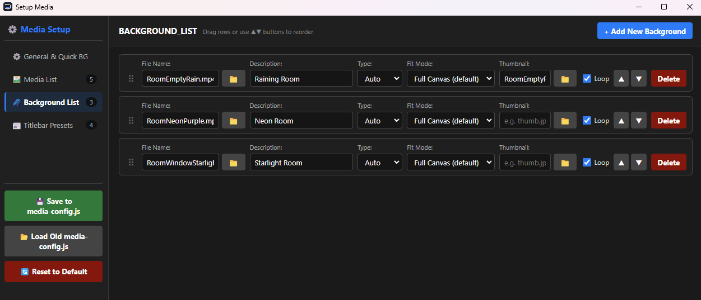
</p>

Works similarly to the Media List, but applies to a set of **Backgrounds** rendered on the **OBS Background** window. Supports both static images and videos.

### 4) Titlebar Presets

<p align="center">
  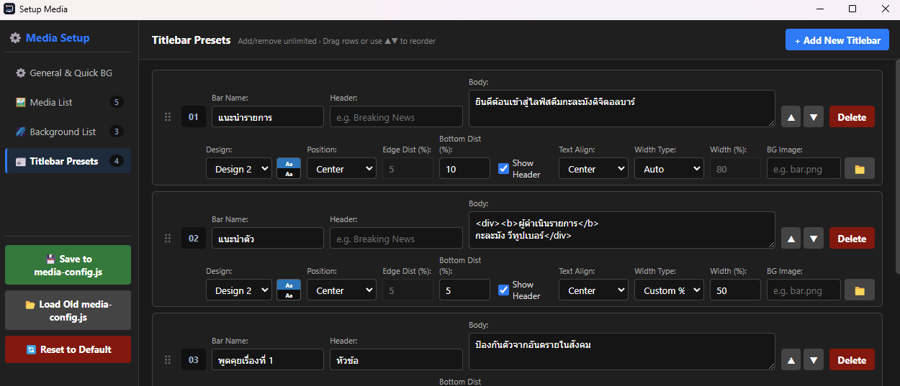
</p>

Pre-configured title bar presets ready to trigger instantly from the Controller (unlimited add/delete).

| Field | Description |
|---|---|
| **Preset Name** | Name displayed on the Controller card |
| **Header** | Header text (optional) |
| **Body** | Main text supporting **HTML** like `<b>bold</b>` or sizing via `<div style="font-size:70px;">…</div>` |
| **Design** | Select design 1–30 (color previews shown next to field) |
| **Position** | Center / Left / Right |
| **Edge Margin (%)** | Distance from left/right edge (used when aligned left or right) |
| **Bottom Margin (%)** | Distance from the bottom of the screen |
| **Show Header** | Checked = Displays the header section |
| **Text Align** | Alignment inside the box: Left / Center / Right |
| **Width / Width (%)** | `Auto` to fit text length or `Custom %` to specify width as a percentage of the screen |
| **Background Image** | Uses an image as a bar background instead of design colors (file must be in `media/`). Blank = Uses design color. |

---

## Controller: Live Control

Open via the **Controller** button in the launcher (or via URL on a mobile/external device). The top menu bar features toggle buttons for **Media**, **Titlebar**, and **Background** groups. If display windows aren't open yet, the status badge reads **DISPLAY DISCONNECTED**.

### Top Menu Bar

| Button | Action |
|---|---|
| ℹ️ | Credits |
| ⌨ | Toggle keyboard shortcuts |
| 📋 | **Copy JSON** Copies current state configuration for manual pasting (see [Saving and Loading Data](#saving-and-loading-data-savejson--media-configjs)) |
| 📁 | **Load** state from `save.json` |
| 💾 | **Overwrite** `save.json` file |
| Media / Titlebar / Background | Open/close control panels |
| How to | Usage and shortcuts |
| Reset | Reset all settings and UI to defaults |

### Media Control + Quick Panel

<p align="center">
  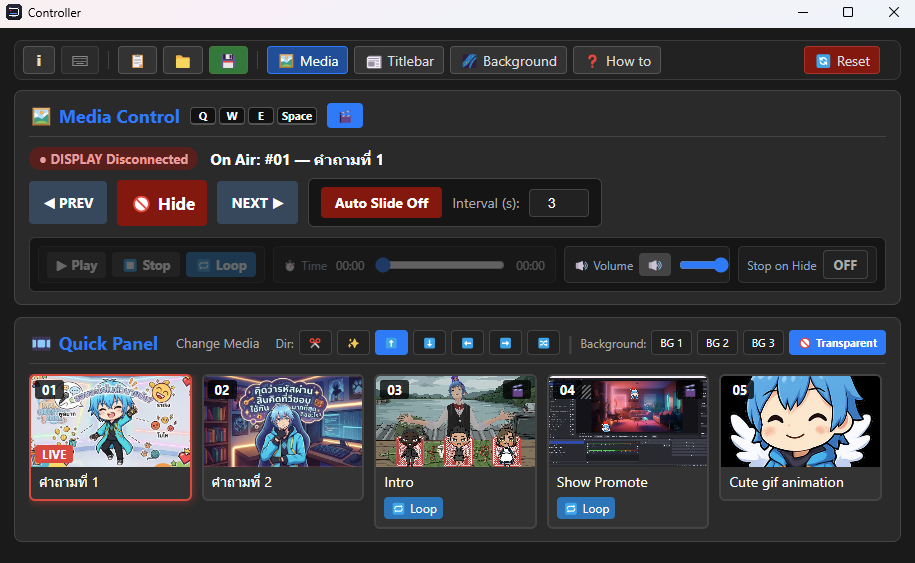
</p>

- **PREV / NEXT:** Switch to previous/next image
- **Show / Hide:** Show or hide image on screen
- **Auto Slide:** Automatically switch images based on timer interval in seconds (Off in image)
- **"ON AIR" Badge:** Indicates which image is currently live
- **🎬 Video Controller** (click to toggle): **Play / Stop / Loop** buttons, timeline bar, **Audio** bar (volume adjustment and mute), **Stop on Hide** (stops video immediately when hidden)
- **Quick Panel:** Click a card to jump directly to that image. Active live cards show a **LIVE** badge, video cards show a 🎬 icon and a **Loop** button.
- **Dir:** Transition effects including ✂️ Cut, ✨ Fade, ⬆️⬇️⬅️➡️ 4-directional Slide, 🔀 Random.
- **BG 1 / 2 / 3 / Transparent Background:** Switch background layer behind images (configured in Setup Media).

### Title Bar Control

<p align="center">
  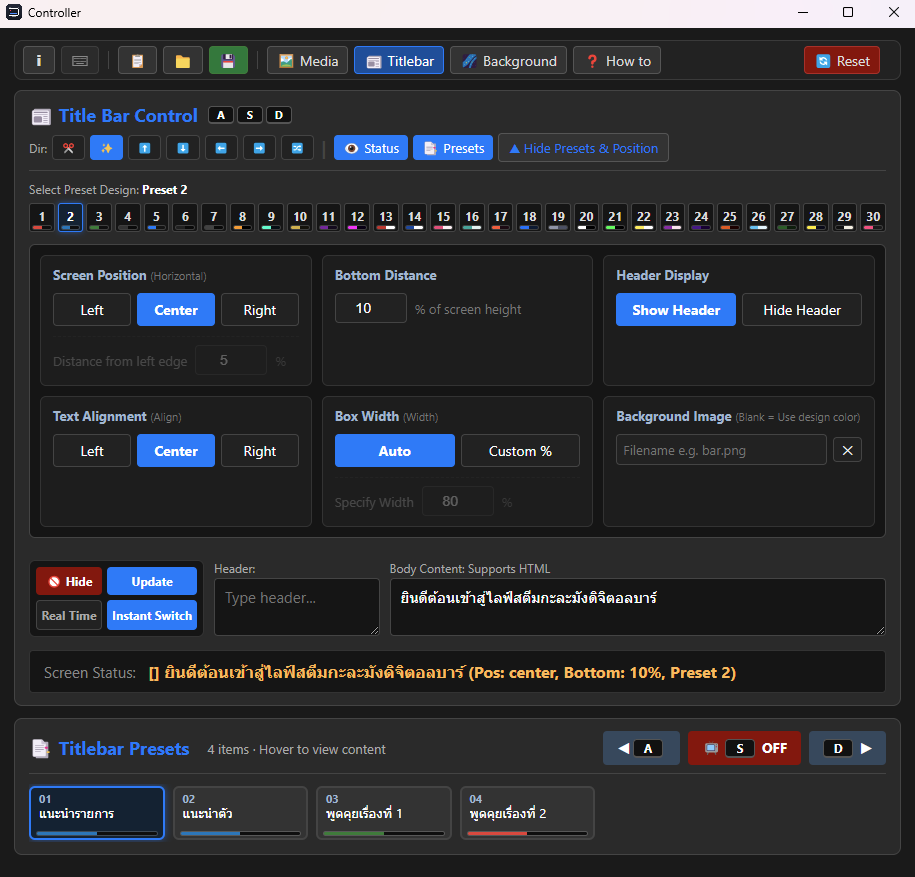
</p>

1. **Select Design (1–30):** Click a number to choose. Selected design displays its name, e.g., *Preset 2*.
2. **Position & Style Settings** in the box below (click **Hide Preset & Position** to collapse)
   - Screen position (Left/Center/Right) · Bottom margin · Show/Hide header · Text alignment · Frame width (Auto/Custom %) · Background image (filename in `media` folder)
3. **Type Text:** **Header** and **Body (HTML supported)** boxes.
4. **Action Buttons**
   - **Show / Hide:** Show or hide Title Bar on screen (Shortcut `S`)
   - **Update:** Push edited text to screen
   - **Real Time:** Instantly updates screen text as you type without pressing Update
   - **Switch Instantly:** Select a preset from the list and bring it live immediately
5. **Dir:** Transition effects for opening/closing/switching Title Bars
6. **Status:** Show/hide status box on screen
7. **Titlebar Presets (Bottom):** Presets configured in Setup Media. Click cards to select, use **A / S / D** to move previous/toggle/next.

### Background Control

<p align="center">
  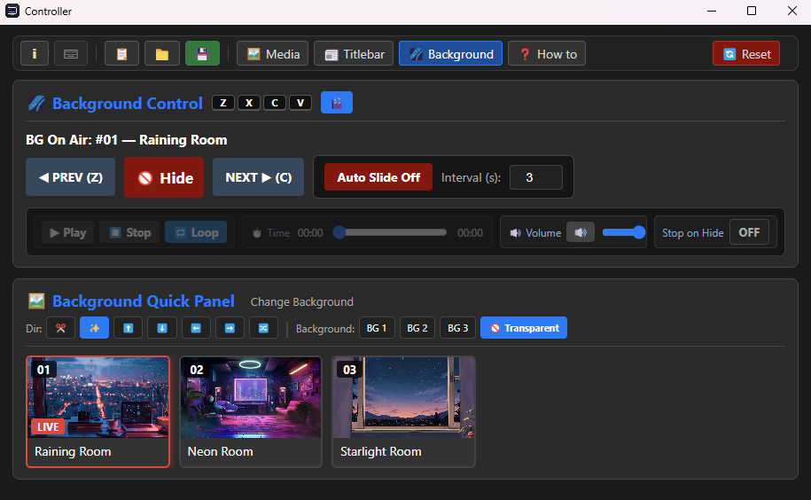
</p>

Functions similarly to Media Control but manages the **OBS Background** window: **PREV / Hide / NEXT**, **Auto Slide**, Quick Panel for quick background selection, Dir, BG 1–3 / Transparent, alongside a Video Controller (🎬 icon) for video backgrounds.

---

## Keyboard Shortcuts

Enable by toggling the ⌨ switch in the Controller menu bar to active status. Shortcuts use **physical key codes**, ensuring they function regardless of keyboard language layouts, and **do not trigger while typing inside text fields**.

| Group | Key | Action |
|---|---|---|
| **Media** | `Q` | Previous image |
| | `W` | Show/Hide image |
| | `E` | Next image |
| | `Space` | Play/Pause video |
| **Titlebar** | `A` | Previous titlebar |
| | `S` | Show/Hide titlebar |
| | `D` | Next titlebar |
| **Background** | `Z` | Previous background |
| | `X` | Show/Hide background |
| | `C` | Next background |
| | `V` | Play/Pause background video |

---

## Saving and Loading Data (save.json / media-config.js)

The application stores data in the `data` folder using two types of files with distinct functions.

| File | What it stores | Edit / Save from where |
|---|---|---|
| **`media-config.js`** | Media lists, videos, backgrounds, Title Bar Presets, Media Base Path, Channel Name | **Setup Media** window |
| **`save.json`** | Controller states like selected Dir effects, Auto Slide, Real Time, keyboard shortcut status, open/closed panels | **Controller** menu bar (📋 📁 💾 buttons) |
| `settings.json` | Window positions/sizes, ports, passwords | Handled automatically by launcher (no manual editing needed) |

### Saving and Loading `media-config.js` (From Setup Media)

**Saving**
1. Modify lists in Setup Media as needed.
2. Click **💾 Overwrite media-config.js**.
3. A file picker opens. Choose the **`media-config.js` file inside the `data` folder** and confirm overwriting (choosing any other file or directory will prevent the Controller from recognizing changes).
4. **Close and reopen the Controller and display windows** from the launcher to load new settings. Configuration files are read only when windows initialize.

**Loading**
- Click **📂 Load old media-config.js** and select the target `media-config.js` file. Settings will populate the setup screen for editing. Remember to overwrite save changes if you intend to use them.

### Saving and Loading `save.json` (From Controller)

| Button | Action |
|---|---|
| 💾 **Save** | Directly overwrites `save.json` (select `save.json` inside the `data` folder) |
| 📁 **Load** | Loads state values from `save.json` |
| 📋 **Copy JSON** | Copies current states as JSON text to paste into `save.json` manually. Used when direct file saving is unavailable (e.g., running Controller as an OBS Dock or from a mobile phone) |

### Moving to Another Machine / Sharing with Others

Copy these 3 items to the same relative locations on the destination computer:

1. The **`media/`** folder (all images and videos)
2. The **`data/media-config.js`** file
3. The **`data/save.json`** file

> Having only `media-config.js` without the `media` folder will populate lists completely without displaying images due to missing source files.

### Backup Tips

Before making major edits, back up the `data` folder. If a file gets corrupted or a mistake is made, restoring the folder instantly reverts it (corrupted `settings.json` files are automatically backed up as `settings.json.broken` and reset to defaults).

---

## Troubleshooting

<details>
<summary><b>Images/videos do not display on screen (names listed, but screen is blank)</b></summary>

Almost always caused by files missing from the `media` folder or mismatched filenames. Verify:
1. Files are actually inside `media/` (click **Open media folder**)
2. The filename field matches the exact file name including extension and letter casing.
3. `media-config.js` has been saved and the Controller & display windows have been restarted.
</details>

<details>
<summary><b>Banner reads "DISPLAY DISCONNECTED"</b></summary>

Display windows are not open yet. Open **OBS Titlebar / OBS Slides / OBS Background** from the launcher (or open each page's URL in an OBS Browser Source) to establish connection.
</details>

<details>
<summary><b>Changes saved but Controller hasn't updated</b></summary>

Setup Media must overwrite the `media-config.js` file **inside the `data` folder** (not elsewhere), and you must **close and reopen the Controller/display windows** to load new values.
</details>

<details>
<summary><b>OBS window capture shows a black background instead of transparent</b></summary>

Try changing Window Capture's Capture Method to **Windows 10 (1903 and up)**. If unresolved, disable "Transparent" in the launcher, set background color to green, use a Chroma Key filter, or switch to **Browser Source** ([OBS Setup](#obs-setup)).
</details>

<details>
<summary><b>Mobile/other device cannot access Controller</b></summary>

1. Check if **Allow other devices on network** is enabled.
2. Confirm mobile device and computer are on the same Wi-Fi/network.
3. Verify Windows Firewall permits the application (select Private networks).
4. Use the `192.168.x.x` URL (not `127.0.0.1`, which points to localhost) with the correct password appended.
</details>

<details>
<summary><b>Port is in use / application opens twice</b></summary>

Only one main window instance runs at a time; duplicate launches close automatically. If port `8765` is occupied by another process, the application tries the next port or allows custom port configuration under the **Server** section.
</details>

<details>
<summary><b>Electron installation fails (ERR_REQUIRE_ESM)</b></summary>

Node.js is outdated. Update to **version 22 LTS or higher**, delete the `node_modules` folder and `package-lock.json` file, then run `npm install` again.
</details>

<details>
<summary><b>Debugging window errors</b></summary>

Press **F12** inside any display window to open Developer Tools and check the Console tab to report issues.
</details>

---

## 💖 Support the Project

Free tool for streamers and VTubers. If you like it, feel free to support:

- ▶️ [Youtube] [https://www.youtube.com/@KaLaMangVT](https://www.youtube.com/@KaLaMangVT)

- ☕ [SocialBuzz] [https://sociabuzz.com/kalamangvt/donate](https://sociabuzz.com/kalamangvt/donate)

- 💳 [Ko-fi] [https://ko-fi.com/kalamangvt](https://ko-fi.com/kalamangvt)

- 🧧 [EasyDonate] [https://ezdn.app/kalamangvt](https://ezdn.app/kalamangvt)

---

## License

Distributed under the [GPL-3.0](LICENSE) License.
