<div align="center">

  |[ **English** ]|[ [ไทย](./README.th.md) ]|
  
</div>

<p align="center">
  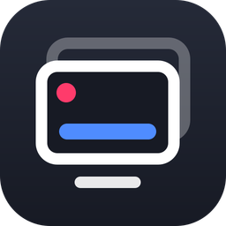
</p>

<h1 align="center">SlideMang</h1>

<p align="center">
  Slide presentation and title bar tool for streamers / VTubers.<br>
  Switch media, backgrounds, cameras and screen captures, insert title bars and change OBS scenes in real-time while streaming.<br>
  <i>โปรแกรมสไลด์และไตเติลสำหรับสตรีมเมอร์ / วีทูปเบอร์ สลับภาพ วิดีโอ พื้นหลัง กล้อง จับภาพหน้าจอ และขึ้นแถบข้อความได้แบบเรียลไทม์</i>
</p>

<p align="center">
  <a href="https://github.com/KaLaMangVT/SlideMang/releases/latest" target="_blank">
    
  </a>
  <a href="https://youtube.com/live/rJrsDisMuC0" target="_blank">
    
  </a>
</p>

---

## Table of Contents

- [What's New in v3](#whats-new-in-v3)
- [What SlideMang Can Do](#what-slidemang-can-do)
- [Workflow Overview](#workflow-overview)
- [Getting Started](#getting-started)
- [Media Files and the media Folder](#media-files-and-the-media-folder)
- [Main Window (Launcher)](#main-window-launcher)
- [Language](#language)
- [OBS Setup](#obs-setup)
- [Network Control (Mobile / Another Device)](#network-control-mobile--another-device)
- [Setup Media: Pre-stream Configuration](#setup-media-pre-stream-configuration)
- [Camera, Screen Capture and OBS Source Slides](#camera-screen-capture-and-obs-source-slides)
- [Controller: Live Control](#controller-live-control)
- [Keyboard Shortcuts](#keyboard-shortcuts)
- [Data Files (config.json / session.json / settings.json)](#data-files-configjson--sessionjson--settingsjson)
- [Upgrading from v2](#upgrading-from-v2)
- [Troubleshooting](#troubleshooting)
- [💖 Support the Project](#-support-the-project)
- [License](#license)

---

## What's New in v3

> v3 is the main version from now on. The old versions (`APP/` and `WEB/` folders) are kept in the repository as they are.

- 🌐 **One program, every language** — English and ไทย in the same `.exe`. Switch any time from the Launcher, Controller or Setup Media.
- 📦 **Fully portable** — `data/` and `media/` sit next to `SlideMang.exe`. Copy the whole folder to another PC and everything comes with it.
- 💾 **Setup Media saves directly** — no more picking `media-config.js` to overwrite. Press **💾 Save** (or `Ctrl+S`).
- 📥 **Files are copied into `media/` for you** — use 📁, **📥 Add files…** or drag & drop files onto the list.
- 🔄 **Everything stays in sync** — saving in Setup Media updates every Controller and OBS display immediately. No more closing and reopening windows.
- 📱 **All Controllers share one live state** (app, browser, phone), and the state is saved automatically.
- ⏱ **Auto Slide runs inside the program** — it never double-steps with two Controllers open and keeps running even with no Controller open.
- 📷 **Camera slides** and 🖥 **window / screen capture slides**, with live adjustment from the Controller and transparent background (black key / color key).
- 📡 **OBS Source slides** — SlideMang turns an OBS source on/off for you through obs-websocket (built into OBS 28+).
- 🎬 **OBS Scenes panel** — buttons that switch OBS scenes, each with its own transition and duration, with live previews.
- 📶 **Live video relay (WebRTC)** — camera/capture slides also work in OBS Browser Sources and displays opened over the network.
- 🗜 **Compact mode** and layouts fixed for small windows.

See the full list on the [Releases](https://github.com/KaLaMangVT/SlideMang/releases) page.

---

## What SlideMang Can Do

- **Switch images and videos** on stream using PREV / NEXT buttons, Quick Panel cards, or keyboard shortcuts, complete with transition effects (Cut, Fade, 4-directional Slide, Random).
- **Show cameras and window / screen captures as slides** — the device is opened only while that slide is on air.
- **Control OBS directly** — turn OBS sources on/off with slides, and switch OBS scenes from the Controller.
- **Insert Title Bars** with 30 built-in designs, live text editing (HTML supported), or pick from prepared presets.
- **Backgrounds** separated into an independent layer using static images, looping videos, cameras, captures or OBS sources.
- **Auto Slide** automatically changes images based on a set timer.
- **Transparent Display Windows** split into 3 separate windows (Titlebar / Slides / Background) ready for OBS Window Capture.
- **Network Control** open the Controller from a mobile phone or another device on the same local network, with OBS Browser Source as an alternative to Window Capture.
- Configure everything through the **Setup Media** screen without touching any code.

---

## Workflow Overview

The program consists of 5 windows that can be opened and closed from the main Launcher window.

| Window | Function |
|---|---|
| **Controller** | Live control panel (switch images, trigger Title Bars, switch OBS scenes, etc.) |
| **Setup Media** | Configure images, videos, cameras, captures, backgrounds, Title Bar presets and OBS scene buttons before streaming |
| **OBS Titlebar** | Title bar display window (for OBS capture) |
| **OBS Slides** | Media/video/camera display window (for OBS capture) |
| **OBS Background** | Background display window (for OBS capture) |

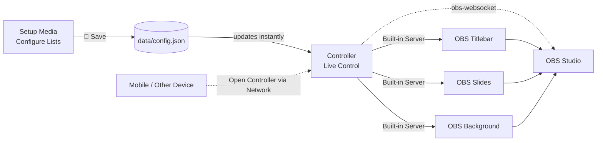

---

## Getting Started

### Method 1: Using the Executable File (.exe)

1. Download `SlideMang.exe` from the [**Releases**](https://github.com/KaLaMangVT/SlideMang/releases) page.
2. Place the file in an empty, writable folder such as `D:\SlideMang\` (do not place it inside `Program Files`).
3. Double-click to run. On first launch, the program creates `data` and `media` folders next to the executable.
4. Choose your language in the Launcher (English is the default).

> Windows may show a SmartScreen warning ("Windows protected your PC") because the program is not digitally signed. Click **More info → Run anyway** if you downloaded it from this repository.

### Method 2: Running from Source Code

1. Install [Node.js](https://nodejs.org) **version 22 LTS or higher** (older versions may fail to install Electron).
2. Open Command Prompt inside the `V3` folder (the one containing `package.json`) and run:

```bash
npm install
npm start
```

3. Run the unit tests:

```bash
npm test
```

4. Build your own portable `.exe` (output: `dist/SlideMang.exe`), or a `.zip`:

```bash
npm run dist
npm run dist:zip
```

> If your folder path contains non-English characters and `npm run dist` fails, move the project to a path with English characters only.

### Folder Structure

```text
SlideMang/
├── SlideMang.exe            ← Application
├── media/                   ← Images and videos (sub-folders allowed)
│   ├── 01.jpg
│   ├── intro/
│   │   └── 03.mp4
│   └── ...
├── data/                    ← Configuration files (managed by the program)
│   ├── config.json          ← Lists and presets (from Setup Media)
│   ├── config.json.bak      ← Backup of the previous save
│   ├── session.json         ← Live Controller state (saved automatically)
│   └── settings.json        ← Launcher, server and OBS connection settings
└── locales/                 ← (optional) extra languages
```

You can click **Open Media Folder** and **Open Data Folder** directly from the Launcher.

---

## Media Files and the media Folder

The program only displays files located inside the `media` folder — but in v3 **you no longer need to copy them by hand**. Setup Media copies files in for you:

| How | What happens |
|---|---|
| 📁 button next to a file field | The chosen file is **copied into `media/`** (or the sub-folder chosen in the toolbar) |
| **Drag & drop** files onto Media List / Background List | Files are copied into `media/` and a row is created for each |
| **📥 Add files…** | Adds several files at once |
| **+ New folder** | Creates a topic sub-folder inside `media/` |

- Free disk space is checked before copying. If it is not enough, nothing is copied and you get a message.
- Identical files are not copied twice. A different file with the same name becomes `name (2).ext`.
- Files missing from `media/` are marked with ⚠ in the list.
- When used from a phone / another PC, files are uploaded to the host computer (password required).

### Tips

- **File Types:** Images (`jpg`, `png`, `gif`, `webp`, etc.) and videos (`mp4`, `webm`, `mov`, `m4v`, `ogv`). If set to "Auto", the program determines the type from the file extension.
- **Video Thumbnails**, **Title Bar background images** and **Quick Backgrounds (BG 1–3)** must also be in `media` (the 📁 button handles that).
- Avoid special characters like `#`, `?`, `%` in filenames as they hold special meanings in web paths. Thai characters and spaces are supported.
- To move to another computer, copy the **whole SlideMang folder** — program, settings and media go together.

---

## Main Window (Launcher)

<p align="center">
  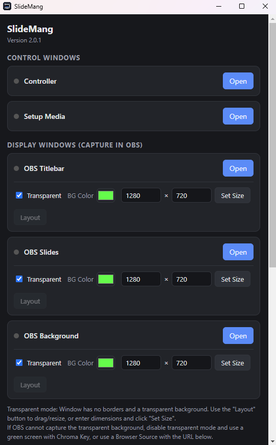
</p>

When you open the application, this window appears. Use it to open/close all other windows.

### Control Windows

Click the **Open / Close** button next to **Controller** and **Setup Media**. A green dot indicates the window is currently active.

### Display Windows (Capture in OBS)

Each window for **OBS Titlebar**, **OBS Slides**, and **OBS Background** has the following options:

| Option | Description |
|---|---|
| **Transparent** | Checked = Window has no borders and a transparent background, ideal for OBS overlay. Unchecked = Standard window (can be dragged and resized). |
| **BG Color** | Used when transparency is disabled, e.g., setting it to green for Chroma Keying in OBS. |
| **Width × Height** + **Set Size** | Sets window dimensions in pixels. Should match your OBS Canvas size (e.g., 1920×1080). |
| **Layout** | Opens "Layout Mode" showing a pink dashed border, a top dragging bar, and a bottom-right corner for resizing. Useful for transparent windows with no borders to grab. (Turn this off before streaming!) |

> Transparent windows cannot be resized by dragging borders normally; use Layout mode or enter dimensions and click **Set Size**.
> Toggling the "Transparent" switch while a window is open will automatically close and reopen it.

### Other Buttons

| Button | Action |
|---|---|
| **🔄 Refresh OBS** | Reloads OBS Titlebar / Slides / Background — both the app windows **and** OBS Browser Sources |
| **Language** | Switch the program language |
| **Open Media Folder / Open Data Folder** | Open the two folders next to the `.exe` |
| **About** | GitHub, Donate and YouTube links |

### Startup

The option **Automatically reopen previously opened windows** restores previously open windows upon the next launch.

---

## Language

SlideMang ships with **English** (default) and **ไทย**. Switch from the Launcher, the Controller menu bar or Setup Media.

**Add your own language**

1. Copy `locales/th.json` to `locales/<code>.json` (e.g. `locales/ja.json`).
2. Change `_meta.name` to the language name.
3. Translate the values — **keys stay in English, do not change them**.
4. Place the `locales` folder next to `SlideMang.exe`. It is loaded automatically, no rebuild needed.

Pull requests with new languages are welcome!

---

## OBS Setup

There are two methods available. Choose **only one method** — do not use both simultaneously, or the images will overlap.

### Method A: Window Capture

1. Open **OBS Titlebar**, **OBS Slides**, and **OBS Background** from the Launcher and match their sizes to your OBS Canvas.
2. In OBS, click **+** under Sources → **Window Capture**.
3. Select the window from the **Window** dropdown ending with `OBS Background`, `OBS Slides`, and `OBS Titlebar` respectively (one source at a time).
4. Set **Capture Method** to **Windows 10 (1903 and up)** and uncheck **Capture Cursor** if you don't want the mouse to show.
5. **Arrange Source Order** from bottom to top: `Background` (bottom) → `Slides` → `Titlebar` (top).

**Audio from Videos:** In OBS, add an **Application Audio Capture** source and select this application's window. Since slides and background audio come from the same program, adjust or mute each section from the Controller (see the 🔊 bar in Media Control and Video Controller for Background).

**If a transparent background appears black:**
- Try changing the Capture Method in OBS.
- Or disable "Transparent" in the Launcher, set the background color to green, and use an OBS **Chroma Key** filter.
- Or use Method B.

### Method B: Browser Source (Using URLs)

1. Check the URL under the **Server / Network Control** section in the Launcher and click **Copy** next to Titlebar / Slides / Background (use the `127.0.0.1` address).
2. In OBS, click **+** → **Browser**, paste the URL, and set the width and height to match your canvas.
3. The advantage is guaranteed transparency without needing to keep the program's display windows open, though the program must remain running.
4. Browser source audio is controlled via the **Control audio via OBS** option in the source's properties.
5. Camera / capture slides are sent to Browser Sources through the [live video relay](#live-video-relay-webrtc).

### Connecting SlideMang to OBS (obs-websocket)

Needed only for **📡 OBS Source** slides and the **🎬 OBS Scenes** panel.

1. In OBS: **Tools → WebSocket Server Settings** → tick **Enable WebSocket server** → **Show Connect Info** to copy the port and password.
2. In SlideMang: **Setup Media → ⚙️ General & Quick BG → 📡 OBS connection** → enter Host, Port (default `4455`) and Password → **🔌 Connect & test**.
3. The connection settings are saved immediately (not with 💾 Save) and stay on this computer.

---

## Network Control (Mobile / Another Device)

<p align="center">
  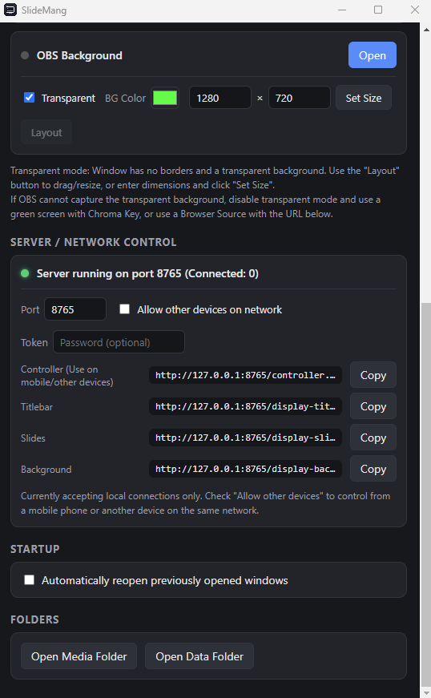
</p>

The program features a built-in server. Since windows communicate through it, you can open the **Controller** from a mobile phone, tablet, or another computer on the same local network (e.g., the same Wi-Fi). **Every open Controller shares the same live state**, so you can use the PC and phone together.

| Option | Description |
|---|---|
| **Port** | Default is `8765`. If the port is in use, the program will try the next available port automatically (check the actual port in the status bar above this section). |
| **Allow other devices on network** | Unchecked = Local device only. Checked = Other devices can access via your machine's IP address (restarts the server automatically upon toggling). |
| **Password** | If set, other devices must enter this password. It is also required to change Setup Media or upload files from other devices. The host machine bypasses this. |
| **Copy Buttons** | Copies the URL for each page (Controller / Titlebar / Slides / Background). |

### How to Use from a Mobile Device

1. Check **Allow other devices on network** and **Set a password**.
2. Click **Copy** on the **Controller** row showing the `192.168.x.x` address (your machine's IP address with the password appended).
3. Send that URL to your mobile device (e.g., via chat) and open it in a browser. The browser will remember the password for subsequent visits.
4. Both the mobile device and computer must be on the same network.

### Security Precautions

- Connections use unencrypted `http`. Only use this on trusted local networks (like home Wi-Fi). **Do not expose the port to the public internet.**
- Set a strong password, avoiding simple ones like `123`.
- The first time external access is enabled, Windows may prompt a **Firewall** alert. Click **Allow access** if you want to use this feature (choose Private networks).

---

## Setup Media: Pre-stream Configuration

Open via the **Setup Media** button in the Launcher. It opens with your current settings already loaded. The left side has a 5-page menu and the save buttons.

### Left-side Buttons

| Button | Action |
|---|---|
| 💾 **Save** (`Ctrl+S`) | Saves everything to `data/config.json` directly (the previous version is kept as `config.json.bak`). Every Controller and OBS display updates **immediately**. |
| 📂 **Open media folder** | Opens the `media` folder |
| ↺ **Reset to Default** | Loads an example with one item in every list (sample images included). Your lists are replaced only when you press Save. |

A **● Unsaved changes** marker appears when there is something to save.

### 1) ⚙️ General & Quick BG

<p align="center">
  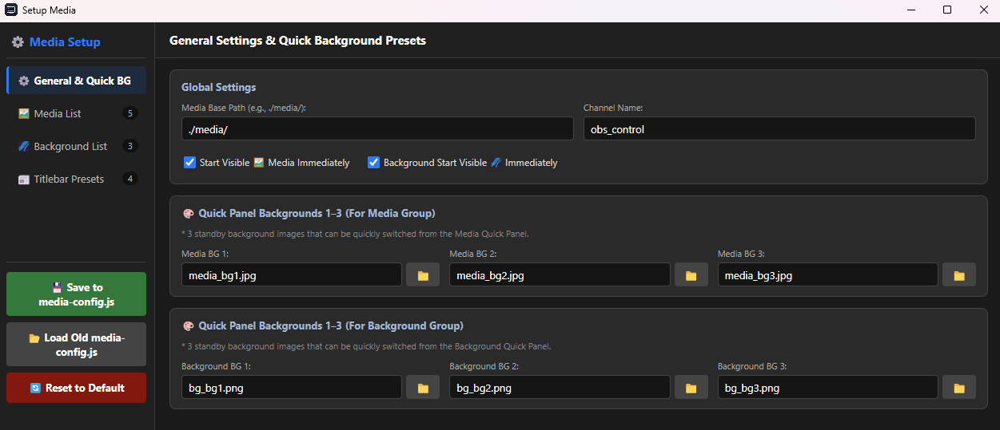
</p>

| Field | Description |
|---|---|
| **Start Visible 🖼️ Media / 🌌 Background Immediately** | Checked = Opens display windows with media/background active right away. Unchecked = Waits for Show command in Controller. |
| **📡 Send camera / capture slides to Browser Sources and network displays (WebRTC)** | Turns the [live video relay](#live-video-relay-webrtc) on/off |
| **📡 OBS connection** | Host / Port / Password for obs-websocket (see [Connecting SlideMang to OBS](#connecting-slidemang-to-obs-obs-websocket)) |
| **Quick Backgrounds (BG 1–3)** | 3 preset images switchable via BG 1 / BG 2 / BG 3 buttons in the Quick Panel, split into Media and Background sets |
| **Advanced → Media Base Path / Channel Name** | Generally doesn't need changing. Change Channel Name only if you run two separate setups on one server. |

### 2) 🖼️ Media List

<p align="center">
  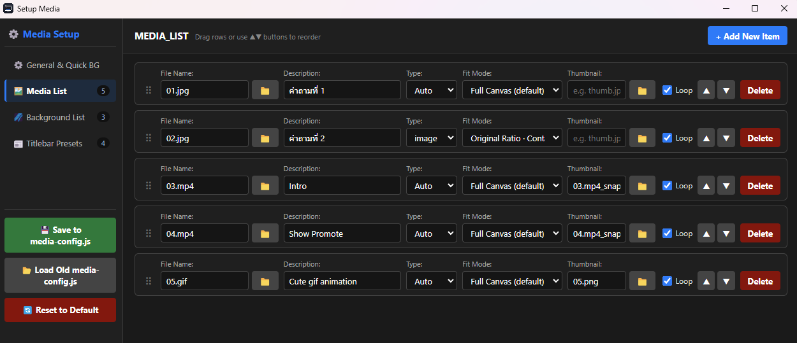
</p>

Each entry represents a card in the Controller's Quick Panel.

**Adding items**

| Button | Adds |
|---|---|
| **+ Add New Item** | An image or video |
| **📥 Add files…** / drag & drop | Several images/videos at once (copied into `media/`) |
| **📷 Add Camera** | A [camera slide](#-camera-slides) |
| **🖥 Add Capture** | A [window / screen capture slide](#-window--screen-capture-slides) |
| **📡 Add OBS Source** | An [OBS Source slide](#-obs-source-slides) |

Reorder by dragging the **⠿** handle or clicking ▲▼. Selecting/dragging text inside a field no longer moves the row. Click **Delete** to remove.

**Image / video fields**

| Field | Description |
|---|---|
| **File Name** | File inside `media/` (📁 copies the chosen file in) |
| **Description** | Text displayed on the Controller card (if left blank when selecting a file, the filename is used) |
| **Type** | `Auto` (inferred from extension), `image`, or `video` if the program guesses incorrectly |
| **Fit Mode** | **Full Canvas** (default), **Actual Size**, **Original Ratio · Contain** (fully visible), **Original Ratio · Cover** (fills screen) |
| **Thumbnail** | Thumbnail image on the card for videos lacking built-in previews |
| **Loop** | Checked = Video loops (default). Unchecked = Plays once. |

### 3) 🌌 Background List

<p align="center">
  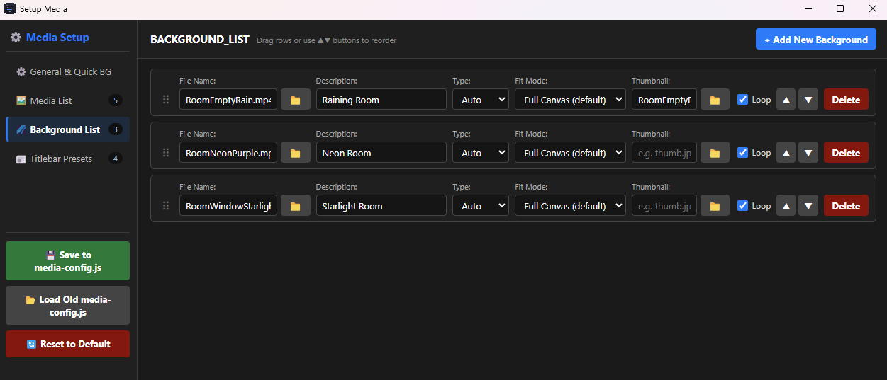
</p>

Works like the Media List, but for the **OBS Background** window. In v3 it also accepts 📷 camera, 🖥 window/screen capture and 📡 OBS Source (Slide or Toggle), with the same on-demand behaviour and video relay as the Media List.

### 4) 📰 Titlebar Presets

<p align="center">
  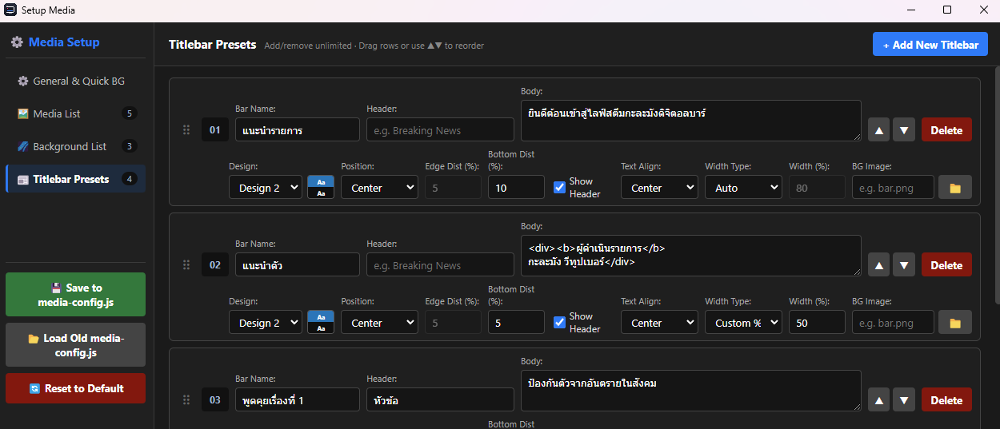
</p>

Pre-configured title bar presets ready to trigger instantly from the Controller (unlimited add/delete).

| Field | Description |
|---|---|
| **Bar Name** | Name displayed on the Controller card |
| **Header** | Header text (optional) |
| **Body** | Main text supporting **HTML** like `<b>bold</b>` or sizing via `<div style="font-size:70px;">…</div>` |
| **Design** | Select design 1–30 (color previews shown next to field) |
| **Position** | Center / Left / Right |
| **Edge Dist (%)** | Distance from left/right edge (used when aligned left or right) |
| **Bottom Dist (%)** | Distance from the bottom of the screen |
| **Show Header** | Checked = Displays the header section |
| **Text Align** | Alignment inside the box: Left / Center / Right |
| **Width** | `Auto` to fit text length or `Custom %` to specify width as a percentage of the screen |
| **Background Image** | Uses an image as a bar background instead of design colors. Blank = Uses design color. |

### 5) 🎬 OBS Scenes

Each entry is a button in the Controller's **🎬 OBS Scenes** panel.

| Field | Description |
|---|---|
| **Button name** | Text on the button |
| **OBS Scene** | Scene to switch to (picked from the list when connected to OBS) |
| **Transition + Duration (ms)** | Used for that switch only, then OBS's own transition is put back |
| **Thumbnail** | (optional) image for the button. Without one, a live preview from OBS is used. |

- The same scene can be added more than once with different transitions.
- With an empty list, the Controller shows every OBS scene.
- Scene switching lives only here (not in the Media or Background lists).

---

## Camera, Screen Capture and OBS Source Slides

### 📷 Camera Slides

A camera shown by SlideMang itself. The camera is opened **only while its slide is on air and Media is shown**, and released right after — image/video-only setups use no extra resources.

- Pick the camera by name, resolution (up to 4K), FPS and mirror.
- Crop edges in %.
- **Transparent background:** Off / Black parts → transparent / Color key (e.g. green screen), with threshold and soft edge.
- If OBS uses the same camera, only one of the two programs can have it at a time.

### 🖥 Window / Screen Capture Slides

A window or screen captured by SlideMang itself, also only while its slide shows.

- Pick a window from thumbnails (matched by window title) or a whole screen.
- Crop edges in %.
- Window capture has no transparency (transparent parts come out black) — use **Black parts → transparent** to fix that.

**Live panel:** while a camera/capture slide is on air, the Controller shows a panel to switch camera/window, mirror, fit and crop, with **💾 Save to Setup** and ↺ undo.

> Camera / capture slides run in the SlideMang display window — capture it with OBS **Window Capture**. For Browser Sources and network displays, see the relay below.

### Live Video Relay (WebRTC)

OBS Browser Sources and displays opened over the network can not open cameras or capture this PC's screen, so SlideMang sends them the video.

- A hidden worker window starts **only** when such a display is showing a camera/capture slide, streams it over the local network (low delay, up to 8 Mbps), and closes 30 s after the last viewer leaves.
- The SlideMang display window still opens the device directly (cheapest for Window Capture on the same PC).
- Use case: OBS on a second PC, or Browser Sources instead of Window Capture.
- On/off: **Setup Media → General**.

### 📡 OBS Source Slides

The capture stays in OBS. SlideMang turns the chosen OBS source **on** while its slide is showing and **off** when the slide changes or Media is hidden. Sources SlideMang does not use are never touched. Requires [obs-websocket](#connecting-slidemang-to-obs-obs-websocket).

| Behaviour | How it works |
|---|---|
| **Slide** (default) | One thing at a time, together with images / videos / cameras |
| **Toggle** | Its card switches that OBS source on/off on its own; the slide does not change, and PREV / NEXT / Auto Slide skip it. It is never touched until you click it, and the card shows the real state in OBS. |

---

## Controller: Live Control

Open via the **Controller** button in the Launcher (or via URL on a mobile/external device). If display windows aren't open yet, the status badge reads **DISPLAY DISCONNECTED**.

### Top Menu Bar

| Button | Action |
|---|---|
| ℹ️ | Credits & About (GitHub / Donate / YouTube) |
| ⌨ | Toggle keyboard shortcuts |
| 📋 | Copy the current state (JSON) |
| 📁 | Import state from a `.json` file |
| 💾 | Export state to a `.json` file (the state is also saved automatically) |
| 🔄 OBS | Reload OBS Titlebar / Slides / Background (app windows and Browser Sources) |
| 🖼️ Media / 📰 Titlebar / 🌌 Background / 🎬 Scenes | Show/hide panel groups (remembered per device) |
| ❓ How to | Usage and shortcuts |
| Language | Switch language |
| 🗜 | Compact mode for a small window |
| ↺ Reset | Reset all settings and UI to defaults |

### Media Control + Quick Panel

<p align="center">
  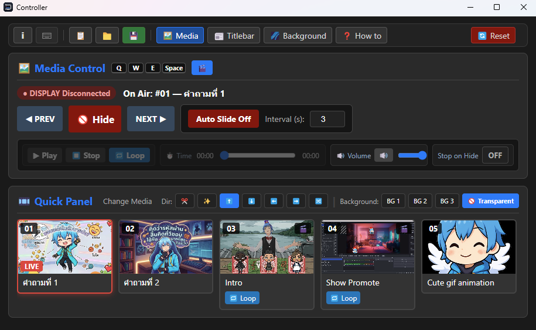
</p>

- **PREV / NEXT:** Switch to previous/next item
- **Show / Hide:** Show or hide media on screen
- **Auto Slide:** Automatically switch items based on a timer in seconds. Runs inside the program, so it keeps going even with no Controller open.
- **"On Air" Badge:** Indicates which item is currently live
- **🎬 Video Controller** (click to toggle): **Play / Stop / Loop** buttons, timeline bar, **Volume** bar (adjust and mute), **Stop on Hide**
- **📷 / 🖥 Live panel:** appears while a camera/capture slide is on air
- **Quick Panel:** Click a card to jump directly to that item. Live cards show a **LIVE** badge, video cards show a 🎬 icon and a **Loop** button, OBS Toggle cards show their real state.
- **Dir:** Transition effects including ✂️ Cut, ✨ Fade, ⬆️⬇️⬅️➡️ 4-directional Slide, 🔀 Random.
- **BG 1 / 2 / 3 / Transparent:** Switch background layer behind images (configured in Setup Media).

### Title Bar Control

<p align="center">
  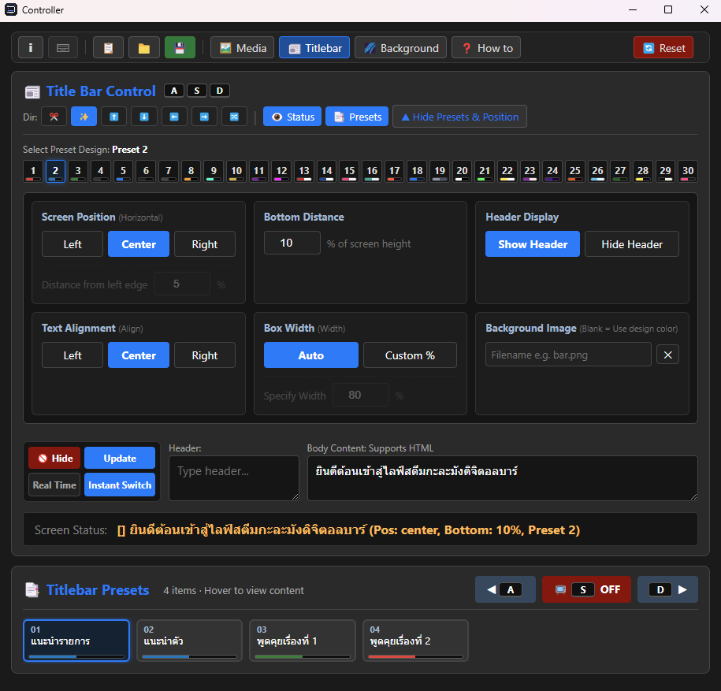
</p>

1. **Select Design (1–30):** Click a number to choose.
2. **Position & Style Settings** (click to collapse): Screen position · Bottom distance · Show/Hide header · Text alignment · Box width (Auto/Custom %) · Background image
3. **Type Text:** **Header** and **Body (HTML supported)** boxes.
4. **Action Buttons**
   - **Show / Hide:** Show or hide Title Bar on screen (Shortcut `S`)
   - **Update:** Push edited text to screen
   - **Real Time:** Instantly updates screen text as you type
   - **Instant Switch:** Select a preset and bring it live immediately
5. **Dir:** Transition effects for opening/closing/switching Title Bars
6. **Status:** Show/hide status box on screen
7. **Titlebar Presets (Bottom):** Click cards to select, use **A / S / D** to move previous/toggle/next.

### Background Control

<p align="center">
  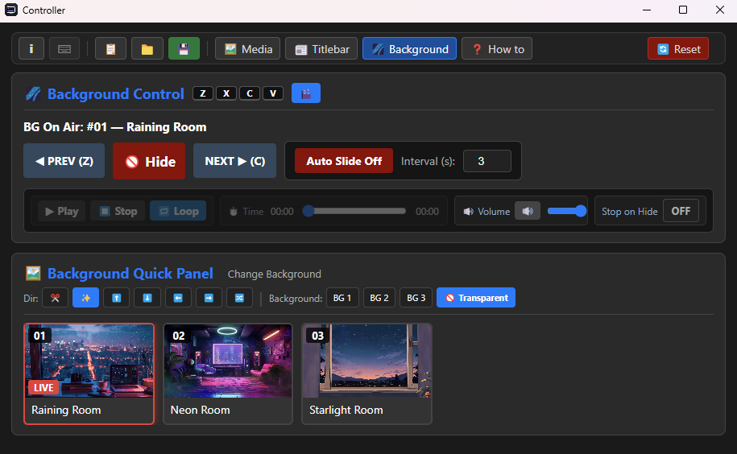
</p>

Functions like Media Control but manages the **OBS Background** window: **PREV / Hide / NEXT**, **Auto Slide**, Quick Panel, Dir, BG 1–3 / Transparent, and a Video Controller (🎬) for video backgrounds.

### 🎬 OBS Scenes

Appears when SlideMang is connected to OBS.

- Click a button to switch the scene in OBS, using that button's own transition.
- The scene on air is highlighted and follows changes made in OBS itself.
- **🔀 Transition** shows the transition on each button.
- Scene previews from OBS: update every 5 s / 15 s / 30 s / 1 min, on air only, by hand (**🔄 Update**) or off.

---

## Keyboard Shortcuts

Enable by toggling the ⌨ switch in the Controller menu bar. Shortcuts use **physical key codes**, so they work regardless of keyboard language layout, and **do not trigger while typing inside text fields**.

| Group | Key | Action |
|---|---|---|
| **Media** | `Q` | Previous item |
| | `W` | Show/Hide media |
| | `E` | Next item |
| | `Space` | Play/Pause video |
| **Titlebar** | `A` | Previous titlebar |
| | `S` | Show/Hide titlebar |
| | `D` | Next titlebar |
| **Background** | `Z` | Previous background |
| | `X` | Show/Hide background |
| | `C` | Next background |
| | `V` | Play/Pause background video |
| **Setup Media** | `Ctrl+S` | Save |

---

## Data Files (config.json / session.json / settings.json)

Everything is stored in the `data` folder and **saved automatically** — you no longer have to pick files to overwrite.

| File | What it stores | Saved from |
|---|---|---|
| **`config.json`** | Media / Background lists, Titlebar Presets, OBS Scene buttons, Quick BG, general options | **Setup Media** → 💾 Save (backup: `config.json.bak`) |
| **`session.json`** | Live Controller state: current item, show/hide, titlebar text, Dir effects, Auto Slide, volume… | Automatically, shared by every Controller |
| **`settings.json`** | Window positions/sizes, language, server port & password, OBS connection (the OBS password is stored here) | Launcher / Setup Media (managed automatically) |

- **📁 / 💾 in the Controller** are now import / export of the state as a `.json` file — useful for keeping several "show" setups.
- **Moving to another machine / sharing:** copy the whole SlideMang folder (`SlideMang.exe` + `data/` + `media/`). Remove `data/settings.json` first if you don't want to share your passwords.
- **Backup:** copy the `data` folder before major edits. A corrupted `settings.json` is automatically backed up as `settings.json.broken` and reset to defaults.

---

## Upgrading from v2

- v3 uses new data files: `data/config.json` and `data/session.json` instead of `media-config.js` and `save.json`.
- Place `SlideMang.exe` (v3) in a **new folder**, copy your old `media` folder next to it, then set up your lists again in Setup Media (📥 **Add files…** or drag & drop makes this quick).
- There is now a single `.exe` for every language — the separate EN / TH builds are no longer needed.

---

## Troubleshooting

<details>
<summary><b>Images/videos do not display (names listed, but screen is blank)</b></summary>

1. Look for ⚠ next to the file name in Setup Media — it means the file is missing from `media/`. Pick it again with 📁 so it gets copied in.
2. Check that you pressed **💾 Save** in Setup Media.
3. Click **🔄 Refresh OBS** in the Launcher or Controller.
</details>

<details>
<summary><b>Banner reads "DISPLAY DISCONNECTED"</b></summary>

Display windows are not open yet. Open **OBS Titlebar / OBS Slides / OBS Background** from the Launcher (or open each page's URL in an OBS Browser Source).
</details>

<details>
<summary><b>OBS Browser Source does not update / shows an old version</b></summary>

Click **🔄 Refresh OBS** in the Launcher or Controller — it reloads Browser Sources too.
</details>

<details>
<summary><b>Camera slide is black / "Camera is busy"</b></summary>

Another program (often OBS) is using the camera. Only one program can use a camera at a time — remove the camera from OBS, or use a **📡 OBS Source** slide instead so the camera stays in OBS.
</details>

<details>
<summary><b>Camera / capture does not show in OBS Browser Source or on another PC</b></summary>

Make sure **📡 Send camera / capture slides to OBS Browser Sources and network displays (WebRTC)** is on in Setup Media → General. The relay starts when the slide goes on air and may take a moment.
</details>

<details>
<summary><b>Window capture shows black where the window should be transparent</b></summary>

Set **Transparent background → Black parts → transparent** on that capture slide, and adjust **Threshold %** if a dark fringe stays.
</details>

<details>
<summary><b>Cannot connect to OBS (OBS Source / OBS Scenes)</b></summary>

1. OBS must be version 28 or newer and running.
2. In OBS: **Tools → WebSocket Server Settings** → **Enable WebSocket server** must be ticked.
3. Copy the port and password from **Show Connect Info** into Setup Media → General → 📡 OBS connection and press **🔌 Connect & test**.
</details>

<details>
<summary><b>OBS window capture shows a black background instead of transparent</b></summary>

Try changing Window Capture's Capture Method to **Windows 10 (1903 and up)**. If unresolved, disable "Transparent" in the Launcher, set background color to green, use a Chroma Key filter, or switch to **Browser Source** ([OBS Setup](#obs-setup)).
</details>

<details>
<summary><b>Mobile/other device cannot access Controller</b></summary>

1. Check if **Allow other devices on network** is enabled.
2. Confirm mobile device and computer are on the same Wi-Fi/network.
3. Verify Windows Firewall permits the application (select Private networks).
4. Use the `192.168.x.x` URL (not `127.0.0.1`, which points to localhost) with the correct password appended.
</details>

<details>
<summary><b>Port is in use / application opens twice</b></summary>

Only one main window instance runs at a time; duplicate launches close automatically. If port `8765` is occupied by another process, the application tries the next port or allows custom port configuration under the **Server** section.
</details>

<details>
<summary><b>Electron installation fails (ERR_REQUIRE_ESM)</b></summary>

Node.js is outdated. Update to **version 22 LTS or higher**, delete the `node_modules` folder and `package-lock.json` file, then run `npm install` again.
</details>

<details>
<summary><b>Debugging window errors</b></summary>

Press **F12** inside any window to open Developer Tools and check the Console tab, then report it on the [Issues](https://github.com/KaLaMangVT/SlideMang/issues) page.
</details>

---

## 💖 Support the Project

Free tool for streamers and VTubers. If you like it, feel free to support:

- ▶️ [Youtube] [https://www.youtube.com/@KaLaMangVT](https://www.youtube.com/@KaLaMangVT)

- ☕ [SocialBuzz] [https://sociabuzz.com/kalamangvt/donate](https://sociabuzz.com/kalamangvt/donate)

- 💳 [Ko-fi] [https://ko-fi.com/kalamangvt](https://ko-fi.com/kalamangvt)

- 🧧 [EasyDonate] [https://ezdn.app/kalamangvt](https://ezdn.app/kalamangvt)

---

## License

Distributed under the [GPL-3.0](LICENSE) License.
