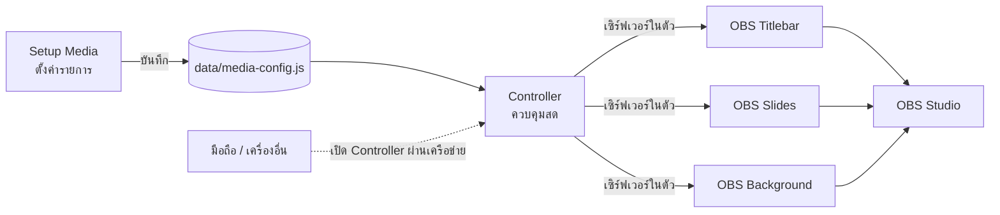
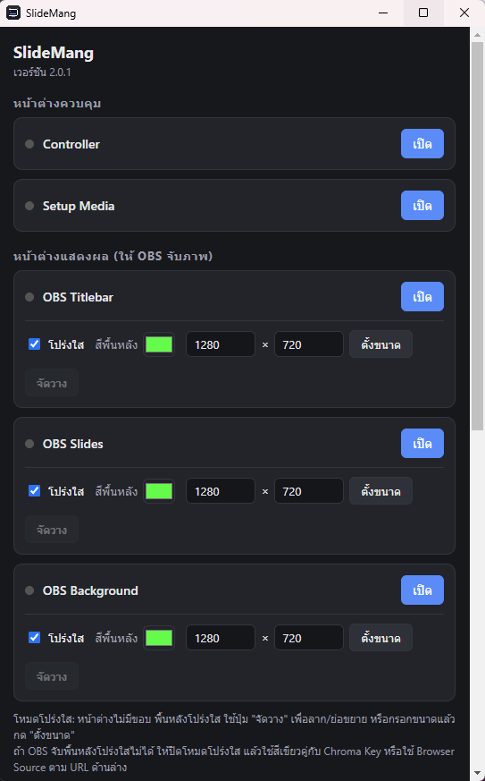
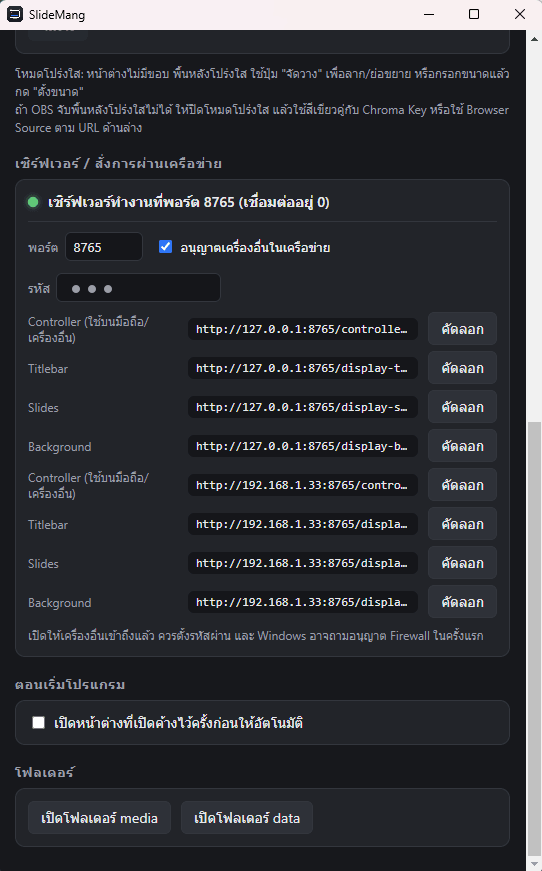
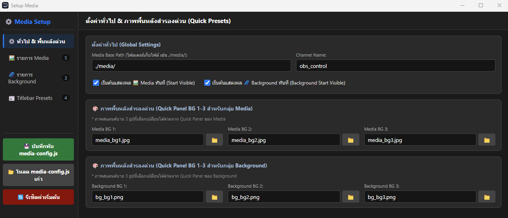
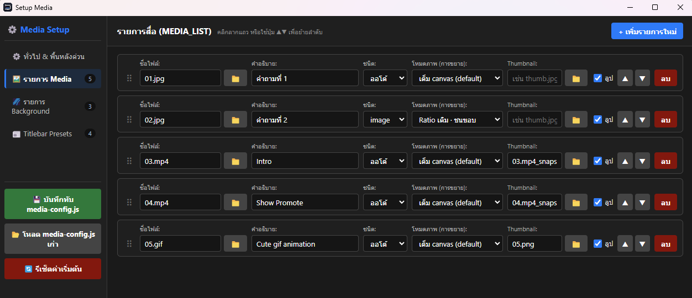
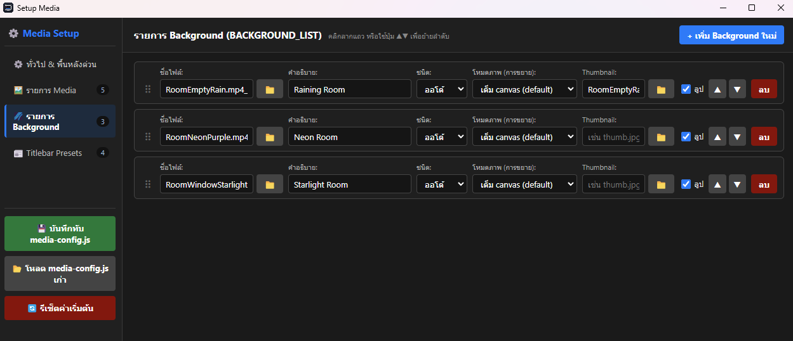
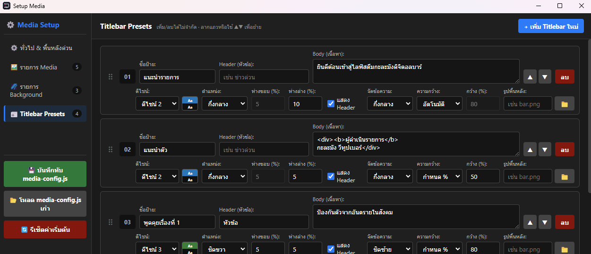
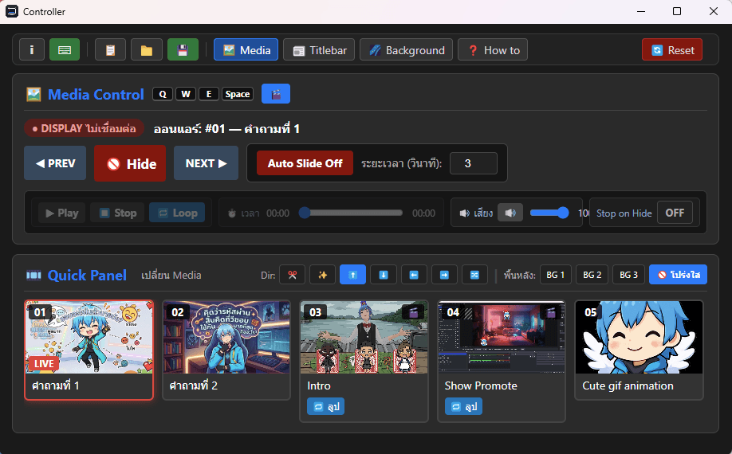
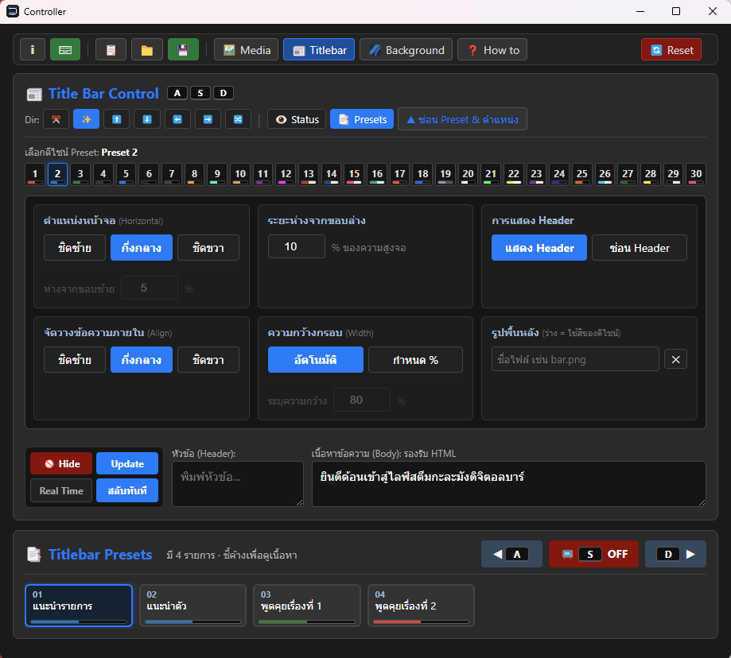
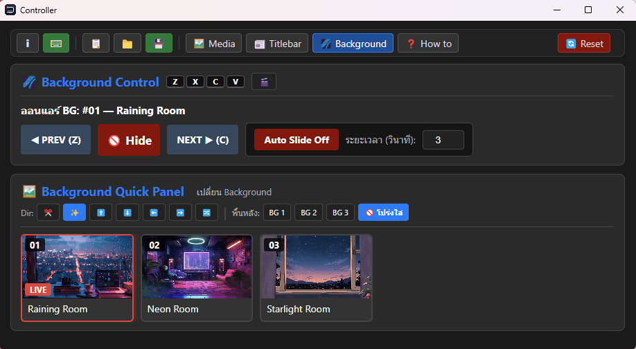

<div align="center">

  |[ [English](./README.md) ]|[ **ไทย** ]|
  
</div>

<p align="center">
  
</p>

<h1 align="center">SlideMang</h1>

<p align="center">
  โปรแกรมสไลด์และไตเติลสำหรับสตรีมเมอร์ / วีทูปเบอร์<br>
  สลับภาพ วิดีโอ พื้นหลัง และขึ้นแถบข้อความ (Title Bar) ได้แบบเรียลไทม์ระหว่างไลฟ์<br>
  <i>Slide presentation for streamer vtuber. Easy to switch media and insert title bar real-time while streaming.</i>
</p>

<p align="center">
  <a href="https://youtube.com/live/rJrsDisMuC0" target="_blank">
    
  </a>
</p>

---

## สารบัญ

- [SlideMang ทำอะไรได้](#slidemang-ทำอะไรได้)
- [ภาพรวมการทำงาน](#ภาพรวมการทำงาน)
- [เริ่มต้นใช้งาน](#เริ่มต้นใช้งาน)
- [สำคัญ: ไฟล์ภาพและวิดีโอต้องอยู่ในโฟลเดอร์ media](#สำคัญ-ไฟล์ภาพและวิดีโอต้องอยู่ในโฟลเดอร์-media)
- [หน้าต่างหลัก (Launcher)](#หน้าต่างหลัก-launcher)
- [ตั้งค่าใช้กับ OBS](#ตั้งค่าใช้กับ-obs)
- [สั่งการผ่านเครือข่าย (มือถือ / เครื่องอื่น)](#สั่งการผ่านเครือข่าย-มือถือ--เครื่องอื่น)
- [Setup Media: ตั้งค่ารายการก่อนไลฟ์](#setup-media-ตั้งค่ารายการก่อนไลฟ์)
- [Controller: ควบคุมระหว่างไลฟ์](#controller-ควบคุมระหว่างไลฟ์)
- [คีย์ลัด](#คีย์ลัด)
- [การบันทึกและโหลดค่า (save.json / media-config.js)](#การบันทึกและโหลดค่า-savejson--media-configjs)
- [ปัญหาที่พบบ่อย](#ปัญหาที่พบบ่อย)
- [💖 Support the Project](#-support-the-project)
- [License](#license)

---

## SlideMang ทำอะไรได้

- **สลับภาพและวิดีโอ** ขึ้นจอไลฟ์ด้วยปุ่ม PREV / NEXT, การ์ด Quick Panel หรือคีย์ลัด พร้อมเอฟเฟกต์ตอนเปลี่ยน (Cut, Fade, Slide 4 ทิศ, สุ่ม)
- **ขึ้นแถบข้อความ (Title Bar)** ด้วยดีไซน์สำเร็จรูป 30 แบบ แก้ข้อความสด (รองรับ HTML) หรือเลือกจากรายการที่เตรียมไว้
- **พื้นหลัง (Background)** แยกอีกชั้น เป็นภาพนิ่งหรือวิดีโอวนลูป
- **Auto Slide** เปลี่ยนภาพอัตโนมัติตามเวลาที่ตั้ง
- **หน้าต่างแสดงผลโปร่งใส** แยกเป็น 3 หน้าต่าง (Titlebar / Slides / Background) ให้ OBS จับภาพด้วย Window Capture ได้
- **สั่งผ่านเครือข่าย** เปิด Controller จากมือถือหรือเครื่องอื่นในวงเดียวกันได้ และใช้ OBS Browser Source เป็นทางเลือกแทน Window Capture
- ตั้งค่ารายการสื่อและแถบข้อความผ่านหน้าจอ **Setup Media** ได้เลย ไม่ต้องแก้โค้ด

---

## ภาพรวมการทำงาน

โปรแกรมประกอบด้วยหน้าต่าง 5 บาน ที่เปิดและปิดได้จากหน้าต่างหลัก (Launcher)

| หน้าต่าง | หน้าที่ |
|---|---|
| **Controller** | แผงควบคุมระหว่างไลฟ์ (สลับภาพ ขึ้น Title Bar ฯลฯ) |
| **Setup Media** | ตั้งค่ารายการภาพ/วิดีโอ/พื้นหลัง/Title Bar ก่อนไลฟ์ |
| **OBS Titlebar** | หน้าต่างแสดงผลแถบข้อความ (ให้ OBS จับภาพ) |
| **OBS Slides** | หน้าต่างแสดงผลภาพ/วิดีโอ (ให้ OBS จับภาพ) |
| **OBS Background** | หน้าต่างแสดงผลพื้นหลัง (ให้ OBS จับภาพ) |



---

## เริ่มต้นใช้งาน

### วิธีที่ 1: ใช้ไฟล์โปรแกรม (.exe)

1. ดาวน์โหลดไฟล์ `.exe` จากหน้า **Releases** ของ repo นี้
2. วางไฟล์ไว้ในโฟลเดอร์ที่คุณต้องการ (แนะนำโฟลเดอร์ว่างที่เขียนไฟล์ได้ เช่น `D:\SlideMang\` ไม่ควรวางใน `Program Files`)
3. ดับเบิลคลิกเปิดโปรแกรม ครั้งแรกโปรแกรมจะสร้างโฟลเดอร์ `data` และ `media` ข้างไฟล์ให้เอง

> Windows อาจขึ้นหน้าต่าง SmartScreen ("Windows protected your PC") เพราะโปรแกรมไม่ได้ลงนามดิจิทัล ให้กด **More info → Run anyway** ถ้าดาวน์โหลดมาจาก repo นี้

### วิธีที่ 2: รันจากซอร์สโค้ด

1. ติดตั้ง [Node.js](https://nodejs.org) เวอร์ชัน **22 LTS ขึ้นไป** (เวอร์ชันเก่ากว่านี้จะติดตั้ง Electron ไม่ผ่าน)
2. เปิด Command Prompt ในโฟลเดอร์โปรแกรม (โฟลเดอร์ `APP` ที่มีไฟล์ `package.json`) แล้วพิมพ์

```bash
npm install
npm start
```

3. ถ้าต้องการสร้างไฟล์ `.exe` ของตัวเอง

```bash
npm run dist
```

> ถ้าเส้นทางโฟลเดอร์มีตัวอักษรภาษาไทยแล้ว `npm run dist` มีปัญหา ให้ย้ายโปรเจกต์ไปไว้เส้นทางภาษาอังกฤษ

### โครงสร้างโฟลเดอร์

```text
SlideMang/
├── SlideMang.exe            ← โปรแกรม
├── media/                   ← วางภาพและวิดีโอทั้งหมดที่นี่
│   ├── 01.jpg
│   ├── 03.mp4
│   └── ...
└── data/                    ← ไฟล์ตั้งค่า
    ├── media-config.js      ← รายการสื่อ / Title Bar (จาก Setup Media)
    ├── save.json            ← สถานะของ Controller
    └── settings.json        ← ตั้งค่าหน้าต่าง / เซิร์ฟเวอร์ (โปรแกรมจัดการเอง)
```

กดปุ่ม **เปิดโฟลเดอร์ media** และ **เปิดโฟลเดอร์ data** ในหน้าต่างหลักเพื่อเปิดสองโฟลเดอร์นี้ได้ทันที

---

## สำคัญ: ไฟล์ภาพและวิดีโอต้องอยู่ในโฟลเดอร์ media

⚠️ **โปรแกรมจะแสดงเฉพาะไฟล์ที่อยู่ในโฟลเดอร์ `media` เท่านั้น**

เหตุผลคือในไฟล์ตั้งค่า โปรแกรมจดจำแค่ **"ชื่อไฟล์"** (เช่น `01.jpg`) ไม่ได้จำตำแหน่งเต็มในไดรฟ์ และไม่ได้คัดลอกไฟล์ให้ ปุ่ม 📁 ข้างช่องชื่อไฟล์ใน Setup Media ก็แค่เปิดหน้าต่างเลือกไฟล์แล้วดึง **"ชื่อ"** ไฟล์ที่เลือกมาใส่ในช่อง เท่านั้น ถ้าคุณเลือกไฟล์จากโฟลเดอร์อื่น (เช่น Desktop หรือ Downloads) ชื่อจะขึ้นในรายการ แต่ตอนแสดงผลโปรแกรมจะหาไฟล์ไม่เจอ ภาพจะไม่ขึ้นบนจอ

### วิธีที่ถูกต้อง

1. **คัดลอกไฟล์** ภาพ/วิดีโอทั้งหมดที่จะใช้ ไปวางในโฟลเดอร์ `media` ก่อน (กด **เปิดโฟลเดอร์ media** ในหน้าต่างหลัก)
2. เปิด **Setup Media** แล้วกดปุ่ม 📁 เลือกไฟล์ **จากโฟลเดอร์ `media`** หรือพิมพ์ชื่อไฟล์ลงในช่องเอง
3. กดบันทึก แล้วเปิด Controller / หน้าต่างแสดงผลใหม่ (ดู[การบันทึกและโหลดค่า](#การบันทึกและโหลดค่า-savejson--media-configjs))

| กรณี | ผล |
|---|---|
| ไฟล์อยู่ใน `media/` แล้วเลือกชื่อนั้น | ✅ แสดงผลปกติ |
| เลือกไฟล์จากที่อื่น (เช่น `D:\Pictures\a.jpg`) โดยไม่ได้คัดลอกเข้า `media/` | ❌ ไม่แสดงผล |
| ชื่อไฟล์ในช่องไม่ตรงกับชื่อจริง (สะกดผิด หรือนามสกุลผิด) | ❌ ไม่แสดงผล |

### เคล็ดลับ

- **ชนิดไฟล์:** ภาพ (`jpg`, `png`, `gif`, `webp` ฯลฯ) และวิดีโอ (`mp4`, `webm`, `mov`, `m4v`, `ogv`) ถ้าตั้งชนิดเป็น "ออโต้" โปรแกรมจะดูจากนามสกุลไฟล์
- **รูปย่อ (Thumbnail) ของวิดีโอ** ก็ต้องเป็นไฟล์ในโฟลเดอร์ `media` เช่นกัน (เช่น ภาพที่แคปจากวิดีโอ)
- **รูปพื้นหลังของ Title Bar** และ **รูปพื้นหลังสำรอง (BG 1–3)** ก็ต้องอยู่ใน `media` เช่นกัน
- หลีกเลี่ยงอักขระ `#` `?` `%` ในชื่อไฟล์ เพราะมีความหมายพิเศษในที่อยู่เว็บ ชื่อภาษาไทยและช่องว่างใช้ได้
- ถ้าจัดไฟล์เป็นโฟลเดอร์ย่อยใน `media` ให้พิมพ์ชื่อพร้อมโฟลเดอร์ย่อยในช่องเอง เช่น `intro/01.jpg` (ปุ่ม 📁 จะใส่แค่ชื่อไฟล์)
- ถ้าย้ายไปเครื่องอื่น ให้ย้ายทั้งโฟลเดอร์ `media` ไปด้วย

---

## หน้าต่างหลัก (Launcher)

<p align="center">
  
</p>

เมื่อเปิดโปรแกรมจะเจอหน้าต่างนี้ ใช้เปิด/ปิดหน้าต่างอื่นทั้งหมด

### หน้าต่างควบคุม

กดปุ่ม **เปิด / ปิด** ข้าง **Controller** และ **Setup Media** จุดสีเขียวหน้าชื่อคือหน้าต่างนั้นเปิดอยู่

### หน้าต่างแสดงผล (ให้ OBS จับภาพ)

แต่ละหน้าต่างของ **OBS Titlebar**, **OBS Slides**, **OBS Background** มีตัวเลือกดังนี้

| ตัวเลือก | คำอธิบาย |
|---|---|
| **โปร่งใส** | ติ๊กไว้ = หน้าต่างไม่มีขอบและพื้นหลังโปร่งใส เหมาะกับการซ้อนใน OBS ถ้าปิดจะเป็นหน้าต่างปกติ (ลากและย่อขยายได้) |
| **สีพื้นหลัง** | ใช้เมื่อปิดโหมดโปร่งใส เช่น ตั้งเป็นสีเขียวเพื่อทำ Chroma Key ใน OBS |
| **กว้าง × สูง** + **ตั้งขนาด** | กำหนดขนาดหน้าต่างเป็นพิกเซล ควรตั้งให้เท่ากับขนาด Canvas ใน OBS (เช่น 1920×1080) |
| **จัดวาง** | เปิด "โหมดจัดวาง" แสดงกรอบประสีชมพู แถบสำหรับลากย้ายตำแหน่งด้านบน และมุมขวาล่างสำหรับลากย่อขยาย ใช้กับหน้าต่างโปร่งใสที่ไม่มีขอบให้จับ (ปิดโหมดนี้ก่อนไลฟ์) |

> หน้าต่างโปร่งใสไม่สามารถลากขอบย่อขยายได้ตามปกติ ให้ใช้โหมดจัดวางหรือกรอกขนาดแล้วกด **ตั้งขนาด**
> การเปลี่ยนสวิตช์ "โปร่งใส" ขณะหน้าต่างเปิดอยู่ โปรแกรมจะปิดและเปิดหน้าต่างนั้นใหม่ให้อัตโนมัติ

### ตอนเริ่มโปรแกรม

ตัวเลือก **เปิดหน้าต่างที่เปิดค้างไว้ครั้งก่อนให้อัตโนมัติ** ถ้าติ๊กไว้ โปรแกรมจะเปิดหน้าต่างที่ค้างไว้เมื่อเปิดโปรแกรมครั้งถัดไป

---

## ตั้งค่าใช้กับ OBS

มีสองวิธี เลือกวิธีใดวิธีหนึ่ง **อย่าใช้ซ้อนกันสองวิธีพร้อมกัน** ไม่เช่นนั้นภาพจะซ้อนกัน

### วิธี A: Window Capture (จับภาพหน้าต่าง)

1. เปิดหน้าต่าง **OBS Titlebar**, **OBS Slides**, **OBS Background** จาก Launcher และตั้งขนาดให้เท่ากับ Canvas ของ OBS
2. ใน OBS กด **+** ใน Sources → **Window Capture** (จับภาพหน้าต่าง)
3. เลือกหน้าต่างจากรายการ **Window** ที่ลงท้ายด้วย `OBS Background`, `OBS Slides`, `OBS Titlebar` ตามลำดับ (ทีละ Source)
4. ตั้ง **Capture Method** เป็น **Windows 10 (1903 and up)** และปิด **Capture Cursor** ถ้าไม่ต้องการให้เห็นเมาส์
5. **เรียงลำดับ Source** จากล่างขึ้นบนดังนี้: `Background` (ล่างสุด) → `Slides` → `Titlebar` (บนสุด)

**เสียงจากวิดีโอ:** ใน OBS เพิ่ม Source ชนิด **Application Audio Capture** (จับเสียงจากแอป) แล้วเลือกหน้าต่างของโปรแกรมนี้ เสียงของ Slides และ Background ออกมาจากโปรแกรมเดียวกัน ให้ปรับ/ปิดเสียงแต่ละส่วนที่ Controller (ดูแถบ 🔊 ของ Media Control และ Video Controller ของ Background)

**ถ้าพื้นหลังที่ควรโปร่งใสกลายเป็นสีดำ:**
- ลองเปลี่ยน Capture Method ใน OBS
- หรือปิด "โปร่งใส" ใน Launcher ตั้งสีพื้นหลังเป็นสีเขียว แล้วใช้ Filter **Chroma Key** ใน OBS
- หรือใช้วิธี B

### วิธี B: Browser Source (ใช้ URL)

1. ดู URL จากส่วน **เซิร์ฟเวอร์** ใน Launcher แล้วกดปุ่ม **คัดลอก** ข้าง Titlebar / Slides / Background (ใช้ที่อยู่ `127.0.0.1`)
2. ใน OBS กด **+** → **Browser** แล้ววาง URL ตั้งความกว้างและความสูงให้เท่ากับ Canvas
3. ข้อดีคือพื้นหลังโปร่งใสแน่นอน และไม่ต้องเปิดหน้าต่างแสดงผลของโปรแกรม (ปิดหน้าต่าง OBS Titlebar / Slides / Background ใน Launcher ได้) แต่ต้องเปิดโปรแกรมและ Controller ทิ้งไว้
4. เสียงของ Browser Source ควบคุมผ่านตัวเลือก **Control audio via OBS** ในหน้า Properties ของ Source นั้น

---

## สั่งการผ่านเครือข่าย (มือถือ / เครื่องอื่น)

<p align="center">
  
</p>

โปรแกรมมีเซิร์ฟเวอร์ในตัว หน้าต่างต่างๆ คุยกันผ่านเซิร์ฟเวอร์นี้ จึงเปิด **Controller** จากมือถือ แท็บเล็ต หรือคอมพิวเตอร์เครื่องอื่นที่อยู่ในเครือข่ายเดียวกัน (เช่น Wi-Fi เดียวกัน) ได้

| ตัวเลือก | คำอธิบาย |
|---|---|
| **พอร์ต** | ค่าเริ่มต้น `8765` ถ้าพอร์ตถูกใช้อยู่ โปรแกรมจะลองพอร์ตถัดไปให้เอง (ดูพอร์ตจริงที่แถบสถานะด้านบนของส่วนนี้) |
| **อนุญาตเครื่องอื่นในเครือข่าย** | ปิดอยู่ = รับเฉพาะเครื่องนี้ ติ๊ก = เครื่องอื่นเข้าถึงได้ผ่านที่อยู่ IP ของเครื่อง (หลังเปลี่ยน โปรแกรมจะรีสตาร์ตเซิร์ฟเวอร์ให้เอง) |
| **รหัส** | ถ้าตั้งไว้ เครื่องอื่นต้องใส่รหัสนี้ ส่วนเครื่องที่รันโปรแกรมเองไม่ต้องใช้ |
| **ปุ่มคัดลอก** | คัดลอก URL ของแต่ละหน้า (Controller / Titlebar / Slides / Background) |

### วิธีใช้จากมือถือ

1. ติ๊ก **อนุญาตเครื่องอื่นในเครือข่าย** และ **ตั้งรหัส**
2. กด **คัดลอก** ที่แถว **Controller** ที่เป็นที่อยู่ `192.168.x.x` (ที่อยู่ IP ของเครื่องคุณ ซึ่งมีรหัสต่อท้ายอยู่แล้ว)
3. ส่ง URL นั้นไปที่มือถือ (เช่น ส่งเข้าแชตตัวเอง) แล้วเปิดในเบราว์เซอร์ ครั้งแรกจะใช้รหัสจาก URL และเบราว์เซอร์จะจำไว้
4. มือถือและคอมพิวเตอร์ต้องอยู่ในเครือข่ายเดียวกัน

### ข้อควรระวังด้านความปลอดภัย

- การเชื่อมต่อใช้ `http` ไม่ได้เข้ารหัส ควรเปิดเฉพาะในเครือข่ายที่ไว้ใจได้ (เช่น Wi-Fi ที่บ้าน) **ไม่ควรเปิดพอร์ตออกอินเทอร์เน็ต**
- ตั้งรหัสให้เดายาก ไม่ใช้รหัสง่ายๆ อย่าง `123`
- ครั้งแรกที่เปิดให้เครื่องอื่นเข้าถึง Windows อาจถามอนุญาต **Firewall** ให้กด **Allow access** ถ้าต้องการใช้ฟีเจอร์นี้ (เลือกเฉพาะ Private network)

---

## Setup Media: ตั้งค่ารายการก่อนไลฟ์

เปิดจากปุ่ม **Setup Media** ใน Launcher ใช้กำหนดรายการภาพ วิดีโอ พื้นหลัง และ Title Bar ที่จะไปโผล่ใน Controller ด้านซ้ายมีเมนูสลับหน้า 4 หน้า และปุ่มบันทึก/โหลด 3 ปุ่ม

> ก่อนเริ่ม: **ต้องนำไฟล์ไปวางในโฟลเดอร์ `media` ก่อน** (ดู[ส่วนสำคัญด้านบน](#สำคัญ-ไฟล์ภาพและวิดีโอต้องอยู่ในโฟลเดอร์-media))

### ปุ่มด้านซ้าย

| ปุ่ม | ทำอะไร |
|---|---|
| 💾 **บันทึกทับ media-config.js** | บันทึกการตั้งค่าทั้งหมดลงไฟล์ `media-config.js` ให้เลือกไฟล์ `media-config.js` ในโฟลเดอร์ `data` เพื่อบันทึกทับ |
| 📂 **โหลด media-config.js เก่า** | โหลดไฟล์ `media-config.js` เดิมกลับมาแก้ไข (ใช้ย้ายค่าจากเครื่องอื่น หรือกู้คืนจากไฟล์สำรอง) |
| 🔄 **รีเซ็ตค่าเริ่มต้น** | ล้างค่าที่แก้ไขกลับเป็นค่าเริ่มต้น |

### 1) ทั่วไป & พื้นหลังด่วน

<p align="center">
  
</p>

| ช่อง | คำอธิบาย |
|---|---|
| **Media Base Path** | โฟลเดอร์ที่เก็บไฟล์ ค่าเริ่มต้น `./media/` โดยทั่วไปให้คงไว้ตามเดิม |
| **Channel Name** | ชื่อ "ช่องสื่อสาร" ที่หน้าต่างต่างๆ ใช้คุยกัน ค่าเริ่มต้น `obs_control` โดยทั่วไปไม่ต้องแก้ |
| **เริ่มต้นแสดงผล Media / Background ทันที** | ติ๊ก = เปิดหน้าต่างแสดงผลแล้วให้ภาพ/พื้นหลังขึ้นเลย ไม่ติ๊ก = รอกด Show ที่ Controller |
| **ภาพพื้นหลังสำรองด่วน (BG 1–3)** | ภาพ 3 รูปที่เลือกเปลี่ยนเป็น "ฉากหลัง" ได้ด้วยปุ่ม BG 1 / BG 2 / BG 3 ใน Quick Panel แยกเป็นชุดของ Media และของ Background (ไฟล์ต้องอยู่ใน `media/`) |

### 2) รายการ Media

<p align="center">
  
</p>

แต่ละรายการคือการ์ดหนึ่งใบใน Quick Panel ของ Controller กด **+ เพิ่มรายการใหม่** เพื่อเพิ่ม ลากแถว (ไอคอน ⋮⋮) หรือกด ▲▼ เพื่อเรียงลำดับ และกด **ลบ** เพื่อลบ

| ช่อง | คำอธิบาย |
|---|---|
| **ชื่อไฟล์** | ชื่อไฟล์ใน `media/` (ปุ่ม 📁 ช่วยเลือกชื่อจากไฟล์ **ที่อยู่ในโฟลเดอร์ media แล้ว**) |
| **คำอธิบาย** | ข้อความที่แสดงบนการ์ดใน Controller (ถ้าเว้นว่างตอนเลือกไฟล์ โปรแกรมจะใส่ชื่อไฟล์ให้) |
| **ชนิด** | `ออโต้` (ดูจากนามสกุลไฟล์), `image` หรือ `video` ใช้เมื่อโปรแกรมเดาผิด |
| **โหมดภาพ (การขยาย)** | วิธีวางภาพบนจอ: **เต็ม canvas** (ค่าเริ่มต้น), **ขนาดตามจริง**, **Ratio เดิม · ชนขอบ** (คงสัดส่วน เห็นภาพครบ), **Ratio เดิม · เต็มจอ** (คงสัดส่วน เต็มจอ) ลองสลับดูผลที่หน้าต่างแสดงผล |
| **Thumbnail** | รูปย่อบนการ์ด ใช้กับวิดีโอที่ไม่มีภาพตัวอย่างในตัว ไฟล์ต้องอยู่ใน `media/` |
| **ลูป** | ติ๊ก = วิดีโอเล่นวน (เป็นค่าเริ่มต้น) เอาติ๊กออกถ้าให้เล่นรอบเดียว |

### 3) รายการ Background

<p align="center">
  
</p>

ใช้หลักการเดียวกับรายการ Media แต่เป็นชุดของ **พื้นหลัง** ซึ่งจะขึ้นที่หน้าต่าง **OBS Background** ใช้ได้ทั้งภาพนิ่งและวิดีโอ

### 4) Titlebar Presets

<p align="center">
  
</p>

รายการแถบข้อความสำเร็จรูป เตรียมไว้ล่วงหน้าแล้วกดขึ้นจอได้ทันทีจาก Controller (เพิ่ม/ลบได้ไม่จำกัด)

| ช่อง | คำอธิบาย |
|---|---|
| **ชื่อป้าย** | ชื่อที่แสดงบนการ์ดใน Controller |
| **Header (หัวข้อ)** | ข้อความหัวข้อ (เว้นว่างได้) |
| **Body (เนื้อหา)** | ข้อความหลัก รองรับ **HTML** เช่น `<b>ตัวหนา</b>` หรือกำหนดขนาด `<div style="font-size:70px;">…</div>` |
| **ดีไซน์** | เลือกดีไซน์ 1–30 (มีตัวอย่างสีเล็กๆ ข้างช่อง) |
| **ตำแหน่ง** | กึ่งกลาง / ชิดซ้าย / ชิดขวา |
| **ห่างขอบ (%)** | ระยะห่างจากขอบซ้าย/ขวา (ใช้เมื่อชิดซ้ายหรือชิดขวา) |
| **ห่างล่าง (%)** | ระยะห่างจากขอบล่างของจอ |
| **แสดง Header** | ติ๊ก = แสดงส่วนหัวข้อ |
| **จัดข้อความ** | จัดข้อความในกรอบ: ซ้าย / กึ่งกลาง / ขวา |
| **ความกว้าง / กว้าง (%)** | `อัตโนมัติ` ให้กรอบกว้างตามข้อความ หรือ `กำหนด %` แล้วใส่ความกว้างเป็นเปอร์เซ็นต์ของจอ |
| **รูปพื้นหลัง** | ใช้รูปเป็นพื้นแถบแทนสีของดีไซน์ (ไฟล์ต้องอยู่ใน `media/`) เว้นว่าง = ใช้สีของดีไซน์ |

---

## Controller: ควบคุมระหว่างไลฟ์

เปิดจากปุ่ม **Controller** ใน Launcher (หรือเปิดจากมือถือ/เครื่องอื่นผ่าน URL) แถบเมนูด้านบนมีปุ่มเปิด/ปิดกลุ่ม **Media**, **Titlebar**, **Background** เลือกเปิดเฉพาะกลุ่มที่ต้องใช้ได้ ถ้ายังไม่ได้เปิดหน้าต่างแสดงผล ป้ายสถานะจะขึ้นว่า **DISPLAY ไม่เชื่อมต่อ**

### แถบเมนูด้านบน

| ปุ่ม | ทำอะไร |
|---|---|
| ℹ️ | เครดิตผลงาน |
| ⌨ | เปิด/ปิดคีย์ลัด |
| 📋 | **Copy JSON** คัดลอกค่าปัจจุบันไปวางเอง (ดู[การบันทึกและโหลดค่า](#การบันทึกและโหลดค่า-savejson--media-configjs)) |
| 📁 | **โหลด** ค่าจากไฟล์ `save.json` |
| 💾 | **บันทึกทับ** ไฟล์ `save.json` |
| Media / Titlebar / Background | เปิด/ปิดกลุ่มแผงควบคุม |
| How to | วิธีใช้และคีย์ลัด |
| Reset | รีเซ็ตการตั้งค่าและ UI ทั้งหมดเป็นค่าเริ่มต้น |

### Media Control + Quick Panel

<p align="center">
  
</p>

- **PREV / NEXT:** เปลี่ยนภาพก่อนหน้า/ถัดไป
- **Show / Hide:** แสดงหรือซ่อนภาพบนจอ
- **Auto Slide:** เปลี่ยนภาพอัตโนมัติ ตั้งระยะเวลาเป็นวินาทีได้ (ในภาพเป็น Off)
- **ป้าย "ออนแอร์":** บอกว่าตอนนี้ภาพไหนกำลังขึ้นจอ
- **🎬 Video Controller** (กดปุ่มเพื่อเปิด/ปิด): ปุ่ม **Play / Stop / Loop**, แถบเวลา, แถบ**เสียง** (ปรับระดับและปิดเสียง), **Stop on Hide** (ซ่อนภาพแล้วหยุดวิดีโอทันที)
- **Quick Panel:** กดการ์ดเพื่อข้ามไปภาพนั้นได้เลย การ์ดที่กำลังขึ้นจอจะมีป้าย **LIVE** ส่วนการ์ดวิดีโอมีไอคอน 🎬 และปุ่ม **ลูป**
- **Dir:** เอฟเฟกต์ตอนเปลี่ยนภาพ ได้แก่ ✂️ Cut (ทันที) · ✨ Fade · ⬆️⬇️⬅️➡️ Slide 4 ทิศ · 🔀 สุ่ม
- **พื้นหลัง BG 1 / 2 / 3 / โปร่งใส:** สลับฉากหลังหลังภาพ (ตั้งค่าไฟล์ใน Setup Media)

### Title Bar Control

<p align="center">
  
</p>

1. **เลือกดีไซน์ (1–30):** กดตัวเลขเพื่อเลือก ดีไซน์ที่เลือกจะแสดงชื่อ เช่น *Preset 2*
2. **ตั้งค่าตำแหน่งและรูปแบบ** ในกล่องด้านล่าง (กดปุ่ม **ซ่อน Preset & ตำแหน่ง** เพื่อพับเก็บ)
   - ตำแหน่งหน้าจอ (ชิดซ้าย/กึ่งกลาง/ชิดขวา) · ระยะห่างจากขอบล่าง · แสดง/ซ่อน Header · จัดวางข้อความ · ความกว้างกรอบ (อัตโนมัติ/กำหนด %) · รูปพื้นหลัง (ชื่อไฟล์ในโฟลเดอร์ `media`)
3. **พิมพ์ข้อความ:** ช่อง **หัวข้อ (Header)** และ **เนื้อหา (Body, รองรับ HTML)**
4. **ปุ่มสั่งงาน**
   - **Show / Hide:** ขึ้นหรือซ่อน Title Bar บนจอ (คีย์ลัด `S`)
   - **Update:** ส่งข้อความที่แก้ไขขึ้นจอ
   - **Real Time:** พิมพ์แล้วขึ้นจอทันทีโดยไม่ต้องกด Update
   - **สลับทันที:** เลือก Preset จากรายการแล้วขึ้นจอทันที
5. **Dir:** เอฟเฟกต์ตอนเปิด/ปิด/สลับ Title Bar
6. **Status:** เปิด/ปิดกล่องสถานะบนจอ
7. **Titlebar Presets (ด้านล่าง):** รายการที่เตรียมไว้ใน Setup Media กดการ์ดเพื่อเลือก ใช้ **A / S / D** เพื่อเลื่อนก่อนหน้า/เปิดปิด/ถัดไป

### Background Control

<p align="center">
  
</p>

ใช้งานคล้าย Media Control แต่ควบคุมที่หน้าต่าง **OBS Background**: **PREV / Hide / NEXT**, **Auto Slide**, Quick Panel สำหรับข้ามไปพื้นหลังที่ต้องการ, Dir และ BG 1–3 / โปร่งใส รวมถึง Video Controller (ไอคอน 🎬) สำหรับพื้นหลังที่เป็นวิดีโอ

---

## คีย์ลัด

เปิดใช้โดยกดสวิตช์ ⌨ ในแถบเมนูของ Controller ให้ติดสถานะเปิด คีย์ลัดใช้ **รหัสปุ่มจริง** จึงใช้ได้แม้แป้นพิมพ์เป็นภาษาไทย และ **ไม่ทำงานขณะกำลังพิมพ์ในช่องข้อความ**

| กลุ่ม | ปุ่ม | หน้าที่ |
|---|---|---|
| **Media** | `Q` | ภาพก่อนหน้า |
| | `W` | เปิด/ปิดภาพ (Show/Hide) |
| | `E` | ภาพถัดไป |
| | `Space` | เล่น/หยุดวิดีโอ |
| **Titlebar** | `A` | Titlebar ก่อนหน้า |
| | `S` | เปิด/ปิด Titlebar |
| | `D` | Titlebar ถัดไป |
| **Background** | `Z` | Background ก่อนหน้า |
| | `X` | เปิด/ปิด Background |
| | `C` | Background ถัดไป |
| | `V` | เล่น/หยุดวิดีโอพื้นหลัง |

---

## การบันทึกและโหลดค่า (save.json / media-config.js)

โปรแกรมเก็บค่าไว้ในโฟลเดอร์ `data` เป็นไฟล์สองประเภท ซึ่งมีหน้าที่ต่างกัน

| ไฟล์ | เก็บอะไร | แก้/บันทึกจากที่ไหน |
|---|---|---|
| **`media-config.js`** | รายการภาพ, วิดีโอ, พื้นหลัง, Title Bar Presets, Media Base Path, Channel Name | หน้าต่าง **Setup Media** |
| **`save.json`** | สถานะของ Controller เช่น เอฟเฟกต์ Dir ที่เลือก, Auto Slide, Real Time, คีย์ลัดเปิดอยู่ไหม, แผงไหนเปิด/ปิดอยู่ | แถบเมนูของ **Controller** (ปุ่ม 📋 📁 💾) |
| `settings.json` | ตำแหน่ง/ขนาดหน้าต่าง, พอร์ต, รหัส | โปรแกรมจัดการเองจาก Launcher (ไม่ต้องแก้มือ) |

### บันทึกและโหลด `media-config.js` (จาก Setup Media)

**บันทึก**
1. แก้ไขรายการต่างๆ ใน Setup Media ให้เรียบร้อย
2. กด **💾 บันทึกทับ media-config.js**
3. หน้าต่างเลือกไฟล์จะเปิดขึ้น ให้เลือกไฟล์ **`media-config.js` ในโฟลเดอร์ `data`** แล้วยืนยันการบันทึกทับ (ถ้าเลือกไฟล์อื่นหรือที่อื่น Controller จะไม่เห็นการเปลี่ยนแปลง)
4. **ปิดแล้วเปิด Controller และหน้าต่างแสดงผลใหม่** จาก Launcher เพื่อให้อ่านค่าใหม่ ไฟล์ตั้งค่าถูกอ่านตอนที่หน้าต่างเปิดเท่านั้น

**โหลด**
- กด **📂 โหลด media-config.js เก่า** แล้วเลือกไฟล์ `media-config.js` ที่ต้องการ ค่าจะถูกดึงมาแสดงในหน้า Setup ให้แก้ต่อ แล้วอย่าลืมกดบันทึกทับอีกครั้งถ้าต้องการใช้ค่านี้จริง

### บันทึกและโหลด `save.json` (จาก Controller)

| ปุ่ม | ทำอะไร |
|---|---|
| 💾 **บันทึก** | บันทึกสถานะปัจจุบันทับไฟล์ `save.json` โดยตรง (เลือกไฟล์ `save.json` ในโฟลเดอร์ `data`) |
| 📁 **โหลด** | โหลดค่าจากไฟล์ `save.json` |
| 📋 **Copy JSON** | คัดลอกค่าปัจจุบันเป็นข้อความ JSON ไปวางลงไฟล์ `save.json` เอง ใช้เมื่อบันทึกไฟล์โดยตรงไม่ได้ (เช่น เปิด Controller เป็น Dock ใน OBS หรือเปิดจากมือถือ) |

### ย้ายไปอีกเครื่อง / แบ่งปันให้คนอื่น

คัดลอก 3 อย่างนี้ไปไว้ที่เดียวกันในเครื่องปลายทาง

1. โฟลเดอร์ **`media/`** (ภาพและวิดีโอทั้งหมด)
2. ไฟล์ **`data/media-config.js`**
3. ไฟล์ **`data/save.json`**

> ถ้ามีแต่ `media-config.js` โดยไม่มีโฟลเดอร์ `media` รายการจะขึ้นครบแต่ภาพจะไม่แสดง เพราะไม่มีไฟล์ให้ดึง

### เคล็ดลับการสำรองข้อมูล

ก่อนแก้ไขครั้งใหญ่ ให้คัดลอกโฟลเดอร์ `data` เก็บไว้ ถ้าไฟล์เสียหรือแก้พลาด คัดลอกกลับมาแทนที่ได้ทันที (โปรแกรมจะสำรองไฟล์ `settings.json` ที่เสียไว้เป็น `settings.json.broken` และเริ่มด้วยค่าเริ่มต้นให้อัตโนมัติ)

---

## ปัญหาที่พบบ่อย

<details>
<summary><b>ภาพ/วิดีโอไม่ขึ้นบนจอ (ในรายการมีชื่อ แต่จอว่าง)</b></summary>

เกือบทุกครั้งคือไฟล์ไม่ได้อยู่ในโฟลเดอร์ `media` หรือชื่อไฟล์ไม่ตรงกัน ตรวจสอบ
1. ไฟล์อยู่ใน `media/` จริงหรือไม่ (กด **เปิดโฟลเดอร์ media**)
2. ชื่อไฟล์ในช่อง **ชื่อไฟล์** ตรงกับชื่อจริง รวมถึงนามสกุลและตัวพิมพ์เล็ก/ใหญ่
3. บันทึก `media-config.js` แล้วและปิด/เปิด Controller กับหน้าต่างแสดงผลใหม่แล้วหรือยัง
</details>

<details>
<summary><b>ป้ายขึ้นว่า "DISPLAY ไม่เชื่อมต่อ"</b></summary>

หน้าต่างแสดงผลยังไม่ได้เปิด เปิด **OBS Titlebar / OBS Slides / OBS Background** จาก Launcher (หรือเปิด URL ของแต่ละหน้าใน OBS Browser Source) แล้วป้ายจะเปลี่ยนเป็นเชื่อมต่อ
</details>

<details>
<summary><b>บันทึกแล้วแต่ Controller ไม่เปลี่ยนตาม</b></summary>

Setup Media ต้องบันทึกทับไฟล์ `media-config.js` **ในโฟลเดอร์ `data`** (ไม่ใช่ที่อื่น) และต้อง **ปิดแล้วเปิด Controller / หน้าต่างแสดงผลใหม่** เพื่อให้โหลดค่าใหม่
</details>

<details>
<summary><b>OBS จับภาพแล้วพื้นหลังเป็นสีดำ ไม่โปร่งใส</b></summary>

ลองตั้ง Capture Method ของ Window Capture เป็น **Windows 10 (1903 and up)** ถ้ายังไม่ได้ ให้ปิด "โปร่งใส" ใน Launcher แล้วใช้ Chroma Key สีเขียว หรือเปลี่ยนไปใช้ **Browser Source** (ดู[ตั้งค่าใช้กับ OBS](#ตั้งค่าใช้กับ-obs))
</details>

<details>
<summary><b>มือถือ/เครื่องอื่นเข้า Controller ไม่ได้</b></summary>

1. ติ๊ก **อนุญาตเครื่องอื่นในเครือข่าย** แล้วหรือยัง
2. มือถือและคอมพิวเตอร์อยู่ใน Wi-Fi/เครือข่ายเดียวกันหรือไม่
3. Firewall ของ Windows อนุญาตโปรแกรมแล้วหรือไม่ (เลือก Private network)
4. ใช้ URL ที่เป็น `192.168.x.x` (ไม่ใช่ `127.0.0.1` ซึ่งหมายถึงเครื่องนั้นเอง) และใส่รหัสท้าย URL ตามที่ Launcher สร้างให้
</details>

<details>
<summary><b>พอร์ตถูกใช้อยู่ / เปิดโปรแกรมซ้อนสองครั้ง</b></summary>

โปรแกรมเปิดได้ครั้งละหนึ่งหน้าต่างหลัก ถ้าเปิดซ้ำ ตัวใหม่จะปิดเอง ถ้าพอร์ต `8765` ถูกโปรแกรมอื่นใช้ โปรแกรมจะลองพอร์ตถัดไปให้ หรือเปลี่ยนพอร์ตเองในส่วน **เซิร์ฟเวอร์**
</details>

<details>
<summary><b>ติดตั้ง Electron ไม่ผ่าน (ERR_REQUIRE_ESM)</b></summary>

Node.js เก่าเกินไป ให้อัปเดตเป็นเวอร์ชัน **22 LTS ขึ้นไป** แล้วลบโฟลเดอร์ `node_modules` กับไฟล์ `package-lock.json` และสั่ง `npm install` ใหม่
</details>

<details>
<summary><b>ดูข้อผิดพลาดของหน้าต่าง</b></summary>

กด **F12** ในหน้าต่างนั้นเพื่อเปิดเครื่องมือนักพัฒนา แล้วดูแท็บ Console ส่งข้อความผิดพลาดมาในหน้า Issues ได้
</details>

---

## 💖 Support the Project

โปรแกรมฟรีสำหรับสตีมเมอร์ วีทูปเบอร์ ถ้าถูกใจค่อยกลับมาปาเงินใส่ก็ยังไม่สาย:

- ▶️ [Youtube] [https://www.youtube.com/@KaLaMangVT](https://www.youtube.com/@KaLaMangVT)

- ☕ [SocialBuzz] [https://sociabuzz.com/kalamangvt/donate](https://sociabuzz.com/kalamangvt/donate)

- 💳 [Ko-fi] [https://ko-fi.com/kalamangvt](https://ko-fi.com/kalamangvt)

- 🧧 [EasyDonate] [https://ezdn.app/kalamangvt](https://ezdn.app/kalamangvt)

---

## License

เผยแพร่ภายใต้สัญญาอนุญาต [GPL-3.0](LICENSE)
