<div align="center">

  |[ [English](./README.md) ]|[ **ไทย** ]|
  
</div>

<p align="center">
  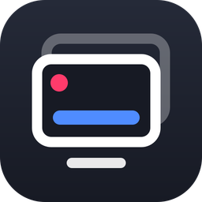
</p>

<h1 align="center">SlideMang</h1>

<p align="center">
  โปรแกรมสไลด์และไตเติลสำหรับสตรีมเมอร์ / วีทูปเบอร์<br>
  สลับภาพ วิดีโอ พื้นหลัง กล้อง จับภาพหน้าจอ ขึ้นแถบข้อความ (Title Bar) และเปลี่ยน Scene ใน OBS ได้แบบเรียลไทม์ระหว่างไลฟ์<br>
  <i>Slide presentation for streamer vtuber. Easy to switch media and insert title bar real-time while streaming.</i>
</p>

<p align="center">
  <a href="https://github.com/KaLaMangVT/SlideMang/releases/latest" target="_blank">
    
  </a>
  <a href="https://youtube.com/live/rJrsDisMuC0" target="_blank">
    
  </a>
</p>

---

## สารบัญ

- [มีอะไรใหม่ใน v3](#มีอะไรใหม่ใน-v3)
- [SlideMang ทำอะไรได้](#slidemang-ทำอะไรได้)
- [ภาพรวมการทำงาน](#ภาพรวมการทำงาน)
- [เริ่มต้นใช้งาน](#เริ่มต้นใช้งาน)
- [ไฟล์ภาพ/วิดีโอ และโฟลเดอร์ media](#ไฟล์ภาพวิดีโอ-และโฟลเดอร์-media)
- [หน้าต่างหลัก (Launcher)](#หน้าต่างหลัก-launcher)
- [ภาษา](#ภาษา)
- [ตั้งค่าใช้กับ OBS](#ตั้งค่าใช้กับ-obs)
- [สั่งการผ่านเครือข่าย (มือถือ / เครื่องอื่น)](#สั่งการผ่านเครือข่าย-มือถือ--เครื่องอื่น)
- [Setup Media: ตั้งค่ารายการก่อนไลฟ์](#setup-media-ตั้งค่ารายการก่อนไลฟ์)
- [สไลด์กล้อง จับภาพหน้าจอ และ OBS Source](#สไลด์กล้อง-จับภาพหน้าจอ-และ-obs-source)
- [Controller: ควบคุมระหว่างไลฟ์](#controller-ควบคุมระหว่างไลฟ์)
- [คีย์ลัด](#คีย์ลัด)
- [ไฟล์ข้อมูล (config.json / session.json / settings.json)](#ไฟล์ข้อมูล-configjson--sessionjson--settingsjson)
- [อัปเกรดจาก v2](#อัปเกรดจาก-v2)
- [ปัญหาที่พบบ่อย](#ปัญหาที่พบบ่อย)
- [💖 Support the Project](#-support-the-project)
- [License](#license)

---

## มีอะไรใหม่ใน v3

> v3 เป็นเวอร์ชันหลักนับจากนี้ ส่วนเวอร์ชันเก่า (โฟลเดอร์ `APP/` และ `WEB/`) ยังเก็บไว้ใน repo ตามเดิม

- 🌐 **โปรแกรมเดียว เลือกภาษาได้** — English และไทยอยู่ใน `.exe` ตัวเดียว เปลี่ยนได้ทุกเมื่อจาก Launcher, Controller หรือ Setup Media
- 📦 **Portable เต็มตัว** — `data/` และ `media/` อยู่ข้าง `SlideMang.exe` ก๊อปทั้งโฟลเดอร์ไปเครื่องอื่นได้ทันที
- 💾 **Setup Media บันทึกตรง** — ไม่ต้องเลือกไฟล์ `media-config.js` มาบันทึกทับอีกแล้ว กด **💾 บันทึก** (หรือ `Ctrl+S`) จบ
- 📥 **ก๊อปไฟล์เข้า `media/` ให้เอง** — ใช้ปุ่ม 📁, **📥 เพิ่มไฟล์…** หรือลากไฟล์มาวางในรายการได้เลย
- 🔄 **ทุกหน้าจอตรงกัน** — กดบันทึกใน Setup Media แล้ว Controller และจอ OBS อัปเดตทันที ไม่ต้องปิดเปิดหน้าต่างใหม่
- 📱 **Controller ทุกหน้าใช้สถานะเดียวกัน** (แอป เบราว์เซอร์ มือถือ) และบันทึกสถานะอัตโนมัติ
- ⏱ **Auto Slide นับเวลาที่ตัวโปรแกรม** — เปิด Controller หลายหน้าก็ไม่เปลี่ยนเร็วขึ้น และยังทำงานแม้ปิด Controller
- 📷 **สไลด์กล้อง** และ 🖥 **สไลด์จับภาพหน้าต่าง / หน้าจอ** ปรับสดจาก Controller ได้ และทำพื้นหลังโปร่งใสได้ (ลบสีดำ / คีย์สี)
- 📡 **สไลด์แบบ OBS Source** — SlideMang เปิด/ปิด source ใน OBS ให้เองผ่าน obs-websocket (มีในตัว OBS 28 ขึ้นไป)
- 🎬 **แผง OBS Scenes** — ปุ่มเปลี่ยน Scene ใน OBS แต่ละปุ่มมี Transition และระยะเวลาของตัวเอง พร้อมภาพตัวอย่างสด
- 📶 **ส่งภาพสดต่อ (WebRTC)** — สไลด์กล้อง/จับภาพหน้าจอใช้ได้ใน Browser Source ของ OBS และจอที่เปิดผ่านเครือข่าย
- 🗜 **โหมดกะทัดรัด** และแก้การแสดงผลตอนหน้าต่างเล็ก

ดูรายการทั้งหมดได้ที่หน้า [Releases](https://github.com/KaLaMangVT/SlideMang/releases)

---

## SlideMang ทำอะไรได้

- **สลับภาพและวิดีโอ** ขึ้นจอไลฟ์ด้วยปุ่ม PREV / NEXT, การ์ด Quick Panel หรือคีย์ลัด พร้อมเอฟเฟกต์ตอนเปลี่ยน (Cut, Fade, Slide 4 ทิศ, สุ่ม)
- **แสดงกล้องและจับภาพหน้าต่าง / หน้าจอเป็นสไลด์** เปิดอุปกรณ์เฉพาะตอนที่สไลด์นั้นออนแอร์
- **สั่ง OBS ได้โดยตรง** เปิด/ปิด source ใน OBS ตามสไลด์ และเปลี่ยน Scene จาก Controller
- **ขึ้นแถบข้อความ (Title Bar)** ด้วยดีไซน์สำเร็จรูป 30 แบบ แก้ข้อความสด (รองรับ HTML) หรือเลือกจากรายการที่เตรียมไว้
- **พื้นหลัง (Background)** แยกอีกชั้น เป็นภาพนิ่ง วิดีโอวนลูป กล้อง จับภาพหน้าจอ หรือ OBS Source
- **Auto Slide** เปลี่ยนภาพอัตโนมัติตามเวลาที่ตั้ง
- **หน้าต่างแสดงผลโปร่งใส** แยกเป็น 3 หน้าต่าง (Titlebar / Slides / Background) ให้ OBS จับภาพด้วย Window Capture ได้
- **สั่งผ่านเครือข่าย** เปิด Controller จากมือถือหรือเครื่องอื่นในวงเดียวกันได้ และใช้ OBS Browser Source เป็นทางเลือกแทน Window Capture
- ตั้งค่าทุกอย่างผ่านหน้าจอ **Setup Media** ได้เลย ไม่ต้องแก้โค้ด

---

## ภาพรวมการทำงาน

โปรแกรมประกอบด้วยหน้าต่าง 5 บาน ที่เปิดและปิดได้จากหน้าต่างหลัก (Launcher)

| หน้าต่าง | หน้าที่ |
|---|---|
| **Controller** | แผงควบคุมระหว่างไลฟ์ (สลับภาพ ขึ้น Title Bar เปลี่ยน Scene ใน OBS ฯลฯ) |
| **Setup Media** | ตั้งค่ารายการภาพ/วิดีโอ/กล้อง/จับภาพหน้าจอ/พื้นหลัง/Title Bar/ปุ่ม OBS Scene ก่อนไลฟ์ |
| **OBS Titlebar** | หน้าต่างแสดงผลแถบข้อความ (ให้ OBS จับภาพ) |
| **OBS Slides** | หน้าต่างแสดงผลภาพ/วิดีโอ/กล้อง (ให้ OBS จับภาพ) |
| **OBS Background** | หน้าต่างแสดงผลพื้นหลัง (ให้ OBS จับภาพ) |

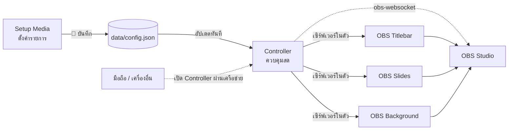

---

## เริ่มต้นใช้งาน

### วิธีที่ 1: ใช้ไฟล์โปรแกรม (.exe)

1. ดาวน์โหลด `SlideMang.exe` จากหน้า [**Releases**](https://github.com/KaLaMangVT/SlideMang/releases)
2. วางไฟล์ไว้ในโฟลเดอร์ว่างที่เขียนไฟล์ได้ เช่น `D:\SlideMang\` (ไม่ควรวางใน `Program Files`)
3. ดับเบิลคลิกเปิดโปรแกรม ครั้งแรกโปรแกรมจะสร้างโฟลเดอร์ `data` และ `media` ข้างไฟล์ให้เอง
4. เลือกภาษาที่ Launcher (ค่าเริ่มต้นเป็น English เลือก **ไทย** ได้)

> Windows อาจขึ้นหน้าต่าง SmartScreen ("Windows protected your PC") เพราะโปรแกรมไม่ได้ลงนามดิจิทัล ให้กด **More info → Run anyway** ถ้าดาวน์โหลดมาจาก repo นี้

### วิธีที่ 2: รันจากซอร์สโค้ด

1. ติดตั้ง [Node.js](https://nodejs.org) เวอร์ชัน **22 LTS ขึ้นไป** (เวอร์ชันเก่ากว่านี้จะติดตั้ง Electron ไม่ผ่าน)
2. เปิด Command Prompt ในโฟลเดอร์ `V3` (โฟลเดอร์ที่มีไฟล์ `package.json`) แล้วพิมพ์

```bash
npm install
npm start
```

3. ทดสอบโค้ด

```bash
npm test
```

4. สร้างไฟล์ `.exe` แบบ portable ของตัวเอง (ได้ไฟล์ `dist/SlideMang.exe`) หรือเป็น `.zip`

```bash
npm run dist
npm run dist:zip
```

> ถ้าเส้นทางโฟลเดอร์มีตัวอักษรภาษาไทยแล้ว `npm run dist` มีปัญหา ให้ย้ายโปรเจกต์ไปไว้เส้นทางภาษาอังกฤษ

### โครงสร้างโฟลเดอร์

```text
SlideMang/
├── SlideMang.exe            ← โปรแกรม
├── media/                   ← ภาพและวิดีโอ (แยกโฟลเดอร์ย่อยได้)
│   ├── 01.jpg
│   ├── intro/
│   │   └── 03.mp4
│   └── ...
├── data/                    ← ไฟล์ตั้งค่า (โปรแกรมจัดการเอง)
│   ├── config.json          ← รายการและ Preset (จาก Setup Media)
│   ├── config.json.bak      ← สำรองของการบันทึกครั้งก่อน
│   ├── session.json         ← สถานะสดของ Controller (บันทึกอัตโนมัติ)
│   └── settings.json        ← ตั้งค่า Launcher เซิร์ฟเวอร์ และการเชื่อมต่อ OBS
└── locales/                 ← (ไม่บังคับ) ภาษาเพิ่มเติม
```

กดปุ่ม **เปิดโฟลเดอร์ media** และ **เปิดโฟลเดอร์ data** ในหน้าต่างหลักเพื่อเปิดสองโฟลเดอร์นี้ได้ทันที

---

## ไฟล์ภาพ/วิดีโอ และโฟลเดอร์ media

โปรแกรมยังแสดงเฉพาะไฟล์ที่อยู่ในโฟลเดอร์ `media` เหมือนเดิม — แต่ใน v3 **ไม่ต้องก๊อปไฟล์เองแล้ว** Setup Media ก๊อปให้อัตโนมัติ

| วิธี | ผล |
|---|---|
| ปุ่ม 📁 ข้างช่องชื่อไฟล์ | ไฟล์ที่เลือกจะถูก **ก๊อปเข้า `media/`** (หรือโฟลเดอร์ย่อยที่เลือกไว้ในแถบด้านบน) |
| **ลากไฟล์มาวาง** ที่รายการ Media / Background | ก๊อปเข้า `media/` และสร้างรายการให้ทีละไฟล์ |
| **📥 เพิ่มไฟล์…** | เพิ่มหลายไฟล์พร้อมกัน |
| **+ สร้างโฟลเดอร์** | สร้างโฟลเดอร์ย่อยใน `media/` สำหรับแยกหัวข้อ |

- เช็คพื้นที่ดิสก์ก่อนก๊อป ถ้าไม่พอจะแจ้งเตือนและไม่ก๊อปเลย
- ไฟล์เดิมซ้ำจะไม่ก๊อปซ้ำ ถ้าชื่อซ้ำแต่คนละไฟล์จะตั้งชื่อเป็น `name (2).ext`
- ไฟล์ที่ไม่มีใน `media/` จะขึ้นเครื่องหมาย ⚠ ในรายการ
- ถ้าเปิด Setup Media จากมือถือ/เครื่องอื่น ไฟล์จะถูกอัปโหลดไปที่เครื่องหลัก (ต้องใช้รหัส)

### เคล็ดลับ

- **ชนิดไฟล์:** ภาพ (`jpg`, `png`, `gif`, `webp` ฯลฯ) และวิดีโอ (`mp4`, `webm`, `mov`, `m4v`, `ogv`) ถ้าตั้งชนิดเป็น "ออโต้" โปรแกรมจะดูจากนามสกุลไฟล์
- **รูปย่อ (Thumbnail) ของวิดีโอ**, **รูปพื้นหลังของ Title Bar** และ **รูปพื้นหลังสำรอง (BG 1–3)** ก็ต้องอยู่ใน `media` เช่นกัน (ใช้ปุ่ม 📁 ก็ก๊อปให้เอง)
- หลีกเลี่ยงอักขระ `#` `?` `%` ในชื่อไฟล์ เพราะมีความหมายพิเศษในที่อยู่เว็บ ชื่อภาษาไทยและช่องว่างใช้ได้
- ถ้าจะย้ายไปเครื่องอื่น ให้ก๊อป **ทั้งโฟลเดอร์ SlideMang** ไปเลย โปรแกรม การตั้งค่า และไฟล์สื่อจะไปด้วยกันหมด

---

## หน้าต่างหลัก (Launcher)

<p align="center">
  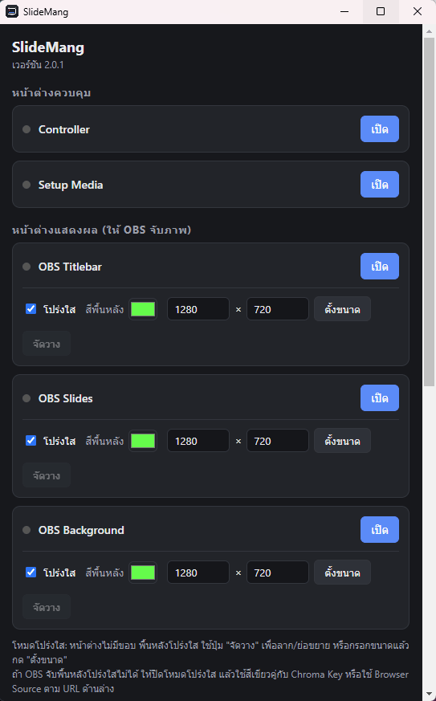
</p>

เมื่อเปิดโปรแกรมจะเจอหน้าต่างนี้ ใช้เปิด/ปิดหน้าต่างอื่นทั้งหมด

### หน้าต่างควบคุม

กดปุ่ม **เปิด / ปิด** ข้าง **Controller** และ **Setup Media** จุดสีเขียวหน้าชื่อคือหน้าต่างนั้นเปิดอยู่

### หน้าต่างแสดงผล (ให้ OBS จับภาพ)

แต่ละหน้าต่างของ **OBS Titlebar**, **OBS Slides**, **OBS Background** มีตัวเลือกดังนี้

| ตัวเลือก | คำอธิบาย |
|---|---|
| **โปร่งใส** | ติ๊กไว้ = หน้าต่างไม่มีขอบและพื้นหลังโปร่งใส เหมาะกับการซ้อนใน OBS ถ้าปิดจะเป็นหน้าต่างปกติ (ลากและย่อขยายได้) |
| **สีพื้นหลัง** | ใช้เมื่อปิดโหมดโปร่งใส เช่น ตั้งเป็นสีเขียวเพื่อทำ Chroma Key ใน OBS |
| **กว้าง × สูง** + **ตั้งขนาด** | กำหนดขนาดหน้าต่างเป็นพิกเซล ควรตั้งให้เท่ากับขนาด Canvas ใน OBS (เช่น 1920×1080) |
| **จัดวาง** | เปิด "โหมดจัดวาง" แสดงกรอบประสีชมพู แถบสำหรับลากย้ายตำแหน่งด้านบน และมุมขวาล่างสำหรับลากย่อขยาย ใช้กับหน้าต่างโปร่งใสที่ไม่มีขอบให้จับ (ปิดโหมดนี้ก่อนไลฟ์) |

> หน้าต่างโปร่งใสไม่สามารถลากขอบย่อขยายได้ตามปกติ ให้ใช้โหมดจัดวางหรือกรอกขนาดแล้วกด **ตั้งขนาด**
> การเปลี่ยนสวิตช์ "โปร่งใส" ขณะหน้าต่างเปิดอยู่ โปรแกรมจะปิดและเปิดหน้าต่างนั้นใหม่ให้อัตโนมัติ

### ปุ่มอื่นๆ

| ปุ่ม | ทำอะไร |
|---|---|
| **🔄 รีเฟรช OBS** | รีโหลด OBS Titlebar / Slides / Background ทั้งหน้าต่างในแอป **และ** Browser Source ใน OBS |
| **ภาษา** | เปลี่ยนภาษาของโปรแกรม |
| **เปิดโฟลเดอร์ media / data** | เปิดสองโฟลเดอร์ที่อยู่ข้าง `.exe` |
| **เกี่ยวกับ** | ลิงก์ GitHub, Donate และ YouTube |

### ตอนเริ่มโปรแกรม

ตัวเลือก **เปิดหน้าต่างที่เปิดค้างไว้ครั้งก่อนให้อัตโนมัติ** ถ้าติ๊กไว้ โปรแกรมจะเปิดหน้าต่างที่ค้างไว้เมื่อเปิดโปรแกรมครั้งถัดไป

---

## ภาษา

SlideMang มีภาษา **English** (ค่าเริ่มต้น) และ **ไทย** เปลี่ยนได้จาก Launcher, แถบเมนูของ Controller หรือหน้า Setup Media

**เพิ่มภาษาเอง**

1. ก๊อป `locales/th.json` เป็น `locales/<รหัสภาษา>.json` (เช่น `locales/ja.json`)
2. แก้ `_meta.name` เป็นชื่อภาษา
3. แปลค่าด้านขวา — **key ด้านซ้ายเป็นภาษาอังกฤษ ห้ามแก้**
4. วางโฟลเดอร์ `locales` ไว้ข้าง `SlideMang.exe` โปรแกรมจะโหลดให้เอง ไม่ต้อง build ใหม่

ส่ง Pull Request ภาษาใหม่มาได้เลย!

---

## ตั้งค่าใช้กับ OBS

มีสองวิธี เลือกวิธีใดวิธีหนึ่ง **อย่าใช้ซ้อนกันสองวิธีพร้อมกัน** ไม่เช่นนั้นภาพจะซ้อนกัน

### วิธี A: Window Capture (จับภาพหน้าต่าง)

1. เปิดหน้าต่าง **OBS Titlebar**, **OBS Slides**, **OBS Background** จาก Launcher และตั้งขนาดให้เท่ากับ Canvas ของ OBS
2. ใน OBS กด **+** ใน Sources → **Window Capture** (จับภาพหน้าต่าง)
3. เลือกหน้าต่างจากรายการ **Window** ที่ลงท้ายด้วย `OBS Background`, `OBS Slides`, `OBS Titlebar` ตามลำดับ (ทีละ Source)
4. ตั้ง **Capture Method** เป็น **Windows 10 (1903 and up)** และปิด **Capture Cursor** ถ้าไม่ต้องการให้เห็นเมาส์
5. **เรียงลำดับ Source** จากล่างขึ้นบนดังนี้: `Background` (ล่างสุด) → `Slides` → `Titlebar` (บนสุด)

**เสียงจากวิดีโอ:** ใน OBS เพิ่ม Source ชนิด **Application Audio Capture** (จับเสียงจากแอป) แล้วเลือกหน้าต่างของโปรแกรมนี้ เสียงของ Slides และ Background ออกมาจากโปรแกรมเดียวกัน ให้ปรับ/ปิดเสียงแต่ละส่วนที่ Controller (ดูแถบ 🔊 ของ Media Control และ Video Controller ของ Background)

**ถ้าพื้นหลังที่ควรโปร่งใสกลายเป็นสีดำ:**
- ลองเปลี่ยน Capture Method ใน OBS
- หรือปิด "โปร่งใส" ใน Launcher ตั้งสีพื้นหลังเป็นสีเขียว แล้วใช้ Filter **Chroma Key** ใน OBS
- หรือใช้วิธี B

### วิธี B: Browser Source (ใช้ URL)

1. ดู URL จากส่วน **เซิร์ฟเวอร์ / สั่งการผ่านเครือข่าย** ใน Launcher แล้วกดปุ่ม **คัดลอก** ข้าง Titlebar / Slides / Background (ใช้ที่อยู่ `127.0.0.1`)
2. ใน OBS กด **+** → **Browser** แล้ววาง URL ตั้งความกว้างและความสูงให้เท่ากับ Canvas
3. ข้อดีคือพื้นหลังโปร่งใสแน่นอน และไม่ต้องเปิดหน้าต่างแสดงผลของโปรแกรม แต่ต้องเปิดโปรแกรมทิ้งไว้
4. เสียงของ Browser Source ควบคุมผ่านตัวเลือก **Control audio via OBS** ในหน้า Properties ของ Source นั้น
5. สไลด์กล้อง / จับภาพหน้าจอ จะถูกส่งไปที่ Browser Source ผ่าน[การส่งภาพสดต่อ](#ส่งภาพสดต่อ-webrtc)

### เชื่อม SlideMang กับ OBS (obs-websocket)

ต้องใช้เฉพาะกับสไลด์แบบ **📡 OBS Source** และแผง **🎬 OBS Scenes**

1. ใน OBS: **Tools → WebSocket Server Settings** → ติ๊ก **Enable WebSocket server** → กด **Show Connect Info** เพื่อดูพอร์ตและรหัสผ่าน
2. ใน SlideMang: **Setup Media → ⚙️ ทั่วไป & พื้นหลังด่วน → 📡 เชื่อมต่อ OBS** → ใส่ Host, Port (ค่าเริ่มต้น `4455`) และรหัสผ่าน → กด **🔌 เชื่อมต่อ & ทดสอบ**
3. ค่าการเชื่อมต่อบันทึกทันที (ไม่ต้องกด 💾 บันทึก) และเก็บไว้ในเครื่องนี้เท่านั้น

---

## สั่งการผ่านเครือข่าย (มือถือ / เครื่องอื่น)

<p align="center">
  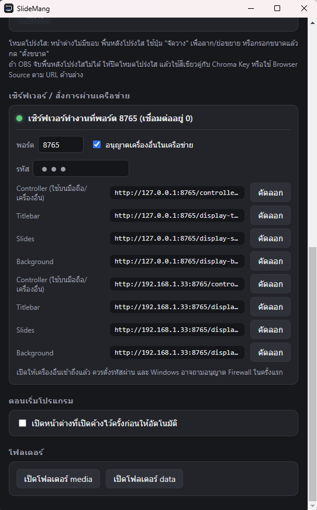
</p>

โปรแกรมมีเซิร์ฟเวอร์ในตัว หน้าต่างต่างๆ คุยกันผ่านเซิร์ฟเวอร์นี้ จึงเปิด **Controller** จากมือถือ แท็บเล็ต หรือคอมพิวเตอร์เครื่องอื่นที่อยู่ในเครือข่ายเดียวกัน (เช่น Wi-Fi เดียวกัน) ได้ **Controller ทุกหน้าที่เปิดอยู่ใช้สถานะเดียวกัน** จึงใช้คอมกับมือถือพร้อมกันได้

| ตัวเลือก | คำอธิบาย |
|---|---|
| **พอร์ต** | ค่าเริ่มต้น `8765` ถ้าพอร์ตถูกใช้อยู่ โปรแกรมจะลองพอร์ตถัดไปให้เอง (ดูพอร์ตจริงที่แถบสถานะด้านบนของส่วนนี้) |
| **อนุญาตเครื่องอื่นในเครือข่าย** | ปิดอยู่ = รับเฉพาะเครื่องนี้ ติ๊ก = เครื่องอื่นเข้าถึงได้ผ่านที่อยู่ IP ของเครื่อง (หลังเปลี่ยน โปรแกรมจะรีสตาร์ตเซิร์ฟเวอร์ให้เอง) |
| **รหัส** | ถ้าตั้งไว้ เครื่องอื่นต้องใส่รหัสนี้ และต้องใช้รหัสนี้เมื่อแก้ Setup Media หรืออัปโหลดไฟล์จากเครื่องอื่น ส่วนเครื่องที่รันโปรแกรมเองไม่ต้องใช้ |
| **ปุ่มคัดลอก** | คัดลอก URL ของแต่ละหน้า (Controller / Titlebar / Slides / Background) |

### วิธีใช้จากมือถือ

1. ติ๊ก **อนุญาตเครื่องอื่นในเครือข่าย** และ **ตั้งรหัส**
2. กด **คัดลอก** ที่แถว **Controller** ที่เป็นที่อยู่ `192.168.x.x` (ที่อยู่ IP ของเครื่องคุณ ซึ่งมีรหัสต่อท้ายอยู่แล้ว)
3. ส่ง URL นั้นไปที่มือถือ (เช่น ส่งเข้าแชตตัวเอง) แล้วเปิดในเบราว์เซอร์ ครั้งแรกจะใช้รหัสจาก URL และเบราว์เซอร์จะจำไว้
4. มือถือและคอมพิวเตอร์ต้องอยู่ในเครือข่ายเดียวกัน

### ข้อควรระวังด้านความปลอดภัย

- การเชื่อมต่อใช้ `http` ไม่ได้เข้ารหัส ควรเปิดเฉพาะในเครือข่ายที่ไว้ใจได้ (เช่น Wi-Fi ที่บ้าน) **ไม่ควรเปิดพอร์ตออกอินเทอร์เน็ต**
- ตั้งรหัสให้เดายาก ไม่ใช้รหัสง่ายๆ อย่าง `123`
- ครั้งแรกที่เปิดให้เครื่องอื่นเข้าถึง Windows อาจถามอนุญาต **Firewall** ให้กด **Allow access** ถ้าต้องการใช้ฟีเจอร์นี้ (เลือกเฉพาะ Private network)

---

## Setup Media: ตั้งค่ารายการก่อนไลฟ์

เปิดจากปุ่ม **Setup Media** ใน Launcher เปิดแล้วจะโหลดค่าปัจจุบันให้เอง ด้านซ้ายมีเมนูสลับหน้า 5 หน้า และปุ่มบันทึก

### ปุ่มด้านซ้าย

| ปุ่ม | ทำอะไร |
|---|---|
| 💾 **บันทึก** (`Ctrl+S`) | บันทึกทุกอย่างลง `data/config.json` ทันที (เก็บของเดิมไว้เป็น `config.json.bak`) Controller และจอ OBS ทุกจอ **อัปเดตทันที** |
| 📂 **เปิดโฟลเดอร์ media** | เปิดโฟลเดอร์ `media` |
| ↺ **รีเซ็ตค่าเริ่มต้น** | โหลดตัวอย่างหัวข้อละ 1 รายการ (มีรูปตัวอย่างให้) รายการเดิมจะถูกแทนที่เมื่อกดบันทึกเท่านั้น |

ถ้ามีอะไรยังไม่ได้บันทึก จะขึ้นป้าย **● ยังไม่ได้บันทึก**

### 1) ⚙️ ทั่วไป & พื้นหลังด่วน

<p align="center">
  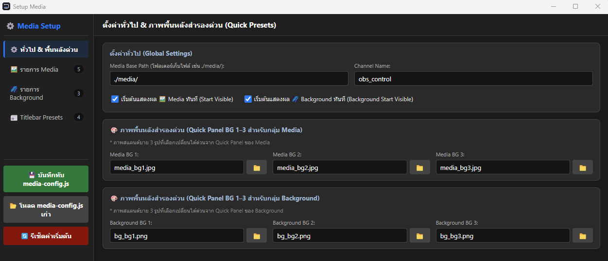
</p>

| ช่อง | คำอธิบาย |
|---|---|
| **เริ่มต้นแสดงผล 🖼️ Media / 🌌 Background ทันที** | ติ๊ก = เปิดหน้าต่างแสดงผลแล้วให้ภาพ/พื้นหลังขึ้นเลย ไม่ติ๊ก = รอกด Show ที่ Controller |
| **📡 ส่งภาพสไลด์กล้อง / จับภาพหน้าจอ ไปยัง Browser Source และจอผ่าน Network (WebRTC)** | เปิด/ปิด[การส่งภาพสดต่อ](#ส่งภาพสดต่อ-webrtc) |
| **📡 เชื่อมต่อ OBS** | Host / Port / รหัสผ่าน ของ obs-websocket (ดู[เชื่อม SlideMang กับ OBS](#เชื่อม-slidemang-กับ-obs-obs-websocket)) |
| **ภาพพื้นหลังสำรองด่วน (BG 1–3)** | ภาพ 3 รูปที่สลับเป็น "ฉากหลัง" ได้ด้วยปุ่ม BG 1 / BG 2 / BG 3 ใน Quick Panel แยกเป็นชุดของ Media และของ Background |
| **ขั้นสูง → Media Base Path / Channel Name** | โดยทั่วไปไม่ต้องแก้ เปลี่ยน Channel Name เฉพาะเมื่อใช้ 2 ชุดแยกกันบนเซิร์ฟเวอร์เดียว |

### 2) 🖼️ รายการ Media

<p align="center">
  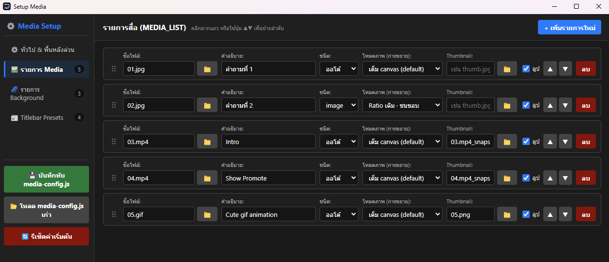
</p>

แต่ละรายการคือการ์ดหนึ่งใบใน Quick Panel ของ Controller

**การเพิ่มรายการ**

| ปุ่ม | เพิ่มอะไร |
|---|---|
| **+ เพิ่มรายการใหม่** | ภาพหรือวิดีโอ |
| **📥 เพิ่มไฟล์…** / ลากไฟล์มาวาง | ภาพ/วิดีโอหลายไฟล์พร้อมกัน (ก๊อปเข้า `media/`) |
| **📷 เพิ่มกล้อง** | [สไลด์กล้อง](#-สไลด์กล้อง) |
| **🖥 เพิ่มจับภาพหน้าจอ** | [สไลด์จับภาพหน้าต่าง / หน้าจอ](#-สไลด์จับภาพหน้าต่าง--หน้าจอ) |
| **📡 เพิ่ม OBS Source** | [สไลด์แบบ OBS Source](#-สไลด์แบบ-obs-source) |

ย้ายลำดับโดยจับที่ **⠿** แล้วลาก หรือกด ▲▼ (ลากเลือกข้อความในช่องพิมพ์จะไม่ไปย้ายลำดับแล้ว) กด **ลบ** เพื่อลบ

**ช่องของภาพ / วิดีโอ**

| ช่อง | คำอธิบาย |
|---|---|
| **ชื่อไฟล์** | ไฟล์ใน `media/` (ปุ่ม 📁 จะก๊อปไฟล์ที่เลือกเข้ามาให้) |
| **คำอธิบาย** | ข้อความที่แสดงบนการ์ดใน Controller (ถ้าเว้นว่างตอนเลือกไฟล์ โปรแกรมจะใส่ชื่อไฟล์ให้) |
| **ชนิด** | `ออโต้` (ดูจากนามสกุลไฟล์), `image` หรือ `video` ใช้เมื่อโปรแกรมเดาผิด |
| **โหมดภาพ (การขยาย)** | **เต็ม canvas** (ค่าเริ่มต้น), **ขนาดตามจริง**, **Ratio เดิม · ชนขอบ** (เห็นภาพครบ), **Ratio เดิม · เต็มจอ** |
| **Thumbnail** | รูปย่อบนการ์ด ใช้กับวิดีโอที่ไม่มีภาพตัวอย่างในตัว |
| **ลูป** | ติ๊ก = วิดีโอเล่นวน (ค่าเริ่มต้น) เอาติ๊กออกถ้าให้เล่นรอบเดียว |

### 3) 🌌 รายการ Background

<p align="center">
  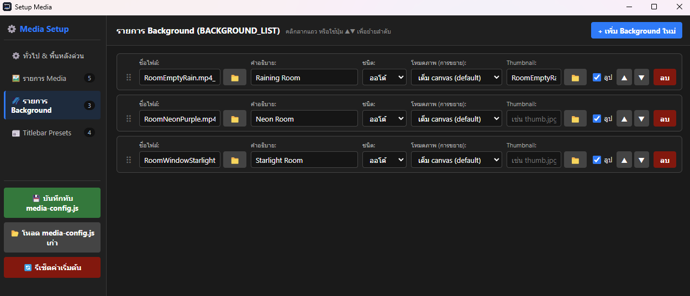
</p>

ใช้หลักการเดียวกับรายการ Media แต่ขึ้นที่หน้าต่าง **OBS Background** ใน v3 ใส่ 📷 กล้อง, 🖥 จับภาพหน้าต่าง/หน้าจอ และ 📡 OBS Source (แบบสไลด์หรือ Toggle) ได้ด้วย ทำงานเฉพาะตอนใช้ และส่งภาพต่อผ่าน WebRTC ได้เหมือน Media List

### 4) 📰 Titlebar Presets

<p align="center">
  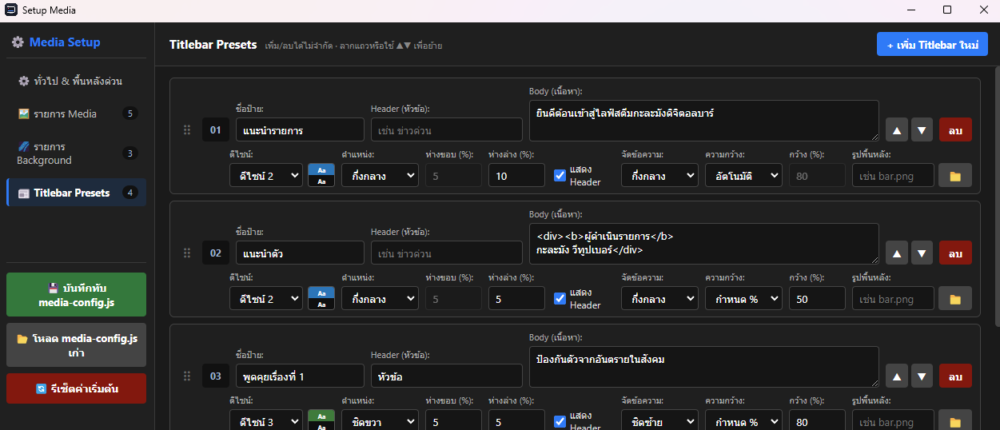
</p>

รายการแถบข้อความสำเร็จรูป เตรียมไว้ล่วงหน้าแล้วกดขึ้นจอได้ทันทีจาก Controller (เพิ่ม/ลบได้ไม่จำกัด)

| ช่อง | คำอธิบาย |
|---|---|
| **ชื่อป้าย** | ชื่อที่แสดงบนการ์ดใน Controller |
| **Header (หัวข้อ)** | ข้อความหัวข้อ (เว้นว่างได้) |
| **Body (เนื้อหา)** | ข้อความหลัก รองรับ **HTML** เช่น `<b>ตัวหนา</b>` หรือกำหนดขนาด `<div style="font-size:70px;">…</div>` |
| **ดีไซน์** | เลือกดีไซน์ 1–30 (มีตัวอย่างสีเล็กๆ ข้างช่อง) |
| **ตำแหน่ง** | กึ่งกลาง / ชิดซ้าย / ชิดขวา |
| **ห่างขอบ (%)** | ระยะห่างจากขอบซ้าย/ขวา (ใช้เมื่อชิดซ้ายหรือชิดขวา) |
| **ห่างล่าง (%)** | ระยะห่างจากขอบล่างของจอ |
| **แสดง Header** | ติ๊ก = แสดงส่วนหัวข้อ |
| **จัดข้อความ** | จัดข้อความในกรอบ: ซ้าย / กึ่งกลาง / ขวา |
| **ความกว้าง** | `อัตโนมัติ` ให้กรอบกว้างตามข้อความ หรือ `กำหนด %` แล้วใส่ความกว้างเป็นเปอร์เซ็นต์ของจอ |
| **รูปพื้นหลัง** | ใช้รูปเป็นพื้นแถบแทนสีของดีไซน์ เว้นว่าง = ใช้สีของดีไซน์ |

### 5) 🎬 OBS Scenes

แต่ละรายการคือปุ่มหนึ่งปุ่มในแผง **🎬 OBS Scenes** ของ Controller

| ช่อง | คำอธิบาย |
|---|---|
| **ชื่อปุ่ม** | ข้อความบนปุ่ม |
| **OBS Scene** | Scene ที่จะเปลี่ยนไป (เลือกจากรายการได้เมื่อเชื่อมต่อ OBS แล้ว) |
| **Transition + ระยะเวลา (ms)** | ใช้เฉพาะตอนกดปุ่มนั้น แล้วคืนค่า Transition เดิมของ OBS |
| **Thumbnail** | (ไม่บังคับ) รูปของปุ่ม ถ้าไม่ใส่จะใช้ภาพตัวอย่างสดจาก OBS |

- Scene เดียวกันเพิ่มได้หลายปุ่มโดยใช้ Transition ต่างกัน
- ถ้าไม่มีรายการ Controller จะแสดงทุก Scene ใน OBS
- การเปลี่ยน Scene มีที่นี่ที่เดียว (ไม่อยู่ใน Media หรือ Background List)

---

## สไลด์กล้อง จับภาพหน้าจอ และ OBS Source

### 📷 สไลด์กล้อง

กล้องที่ SlideMang แสดงเอง จะเปิดกล้อง **เฉพาะตอนที่สไลด์นั้นออนแอร์และ Media แสดงอยู่** แล้วปิดทันทีเมื่อเลิกใช้ คนที่ใช้แค่ภาพ/วิดีโอจึงไม่เสียทรัพยากรเพิ่ม

- เลือกกล้องจากชื่อ ความละเอียด (สูงสุด 4K) FPS และกลับด้าน (Mirror)
- ตัดขอบเป็น %
- **พื้นหลังโปร่งใส:** ปิด / ส่วนสีดำ → โปร่งใส / คีย์สี (เช่น กรีนสกรีน) ปรับระดับการลบและขอบนุ่มได้
- ถ้า OBS ใช้กล้องตัวเดียวกันอยู่ จะใช้ได้ทีละโปรแกรม

### 🖥 สไลด์จับภาพหน้าต่าง / หน้าจอ

หน้าต่างหรือหน้าจอที่ SlideMang จับภาพเอง ทำงานเฉพาะตอนที่สไลด์นั้นแสดงเช่นกัน

- เลือกหน้าต่างจากภาพตัวอย่าง (จับคู่จากชื่อหน้าต่าง) หรือทั้งหน้าจอ
- ตัดขอบเป็น %
- การจับภาพหน้าต่างไม่มีความโปร่งใส (ส่วนที่โปร่งใสจะออกมาเป็นสีดำ) ใช้ **ส่วนสีดำ → โปร่งใส** เพื่อแก้

**แผงปรับสด:** ระหว่างที่สไลด์กล้อง/จับภาพออนแอร์ Controller จะมีแผงให้เปลี่ยนกล้อง/หน้าต่าง กลับด้าน การขยาย ตัดขอบ พร้อมปุ่ม **💾 บันทึกลง Setup** และ ↺ ย้อนกลับ

> สไลด์กล้อง/จับภาพทำงานในหน้าต่างแสดงผลของ SlideMang ให้ OBS จับด้วย **Window Capture** ถ้าใช้ Browser Source หรือจอผ่านเครือข่าย ดูหัวข้อถัดไป

### ส่งภาพสดต่อ (WebRTC)

Browser Source ของ OBS และจอที่เปิดผ่านเครือข่ายเปิดกล้องหรือจับภาพหน้าจอของเครื่องนี้เองไม่ได้ SlideMang จึงส่งวิดีโอไปให้แทน

- หน้าต่างทำงานเบื้องหลัง (ซ่อนอยู่) จะเริ่ม **ก็ต่อเมื่อ** มีจอแบบนี้แสดงสไลด์กล้อง/จับภาพ ส่งภาพผ่านวง LAN (หน่วงต่ำ สูงสุด 8 Mbps) และปิดตัวเอง 30 วินาทีหลังไม่มีคนดู
- หน้าต่างแสดงผลของ SlideMang ยังเปิดอุปกรณ์เองเหมือนเดิม (ประหยัดที่สุดเมื่อใช้ Window Capture ในเครื่องเดียวกัน)
- ใช้กับ OBS อีกเครื่อง หรือใช้ Browser Source แทน Window Capture
- เปิด/ปิดได้ที่ **Setup Media → ทั่วไป**

### 📡 สไลด์แบบ OBS Source

การจับภาพยังอยู่ใน OBS ตามเดิม SlideMang จะ **เปิด** source ที่เลือกใน OBS ขณะที่สไลด์นั้นแสดง และ **ปิด** เมื่อเปลี่ยนสไลด์หรือซ่อน Media ส่วน source อื่นที่ SlideMang ไม่ได้ใช้จะไม่ถูกแตะ ต้อง[เชื่อมต่อ obs-websocket](#เชื่อม-slidemang-กับ-obs-obs-websocket) ก่อน

| การทำงาน | ทำงานอย่างไร |
|---|---|
| **สไลด์** (ค่าเริ่มต้น) | แสดงทีละอย่างร่วมกับภาพ / วิดีโอ / กล้อง |
| **Toggle** | กดการ์ดเพื่อเปิด/ปิด source นั้นใน OBS แยกอิสระ ไม่เปลี่ยนสไลด์ และ PREV / NEXT / Auto Slide จะข้ามไป ตัว Toggle จะไม่ถูกแตะจนกว่าจะกด และการ์ดแสดงสถานะจริงใน OBS |

---

## Controller: ควบคุมระหว่างไลฟ์

เปิดจากปุ่ม **Controller** ใน Launcher (หรือเปิดจากมือถือ/เครื่องอื่นผ่าน URL) ถ้ายังไม่ได้เปิดหน้าต่างแสดงผล ป้ายสถานะจะขึ้นว่า **DISPLAY ไม่เชื่อมต่อ**

### แถบเมนูด้านบน

| ปุ่ม | ทำอะไร |
|---|---|
| ℹ️ | เครดิตและเกี่ยวกับ (GitHub / Donate / YouTube) |
| ⌨ | เปิด/ปิดคีย์ลัด |
| 📋 | คัดลอกสถานะปัจจุบัน (JSON) |
| 📁 | นำเข้าสถานะจากไฟล์ `.json` |
| 💾 | ส่งออกสถานะเป็นไฟล์ `.json` (สถานะถูกบันทึกอัตโนมัติอยู่แล้ว) |
| 🔄 OBS | รีเฟรช OBS Titlebar / Slides / Background (ทั้งหน้าต่างในแอปและ Browser Source) |
| 🖼️ Media / 📰 Titlebar / 🌌 Background / 🎬 Scenes | เปิด/ปิดกลุ่มแผงควบคุม (จำแยกตามเครื่อง) |
| ❓ วิธีใช้ | วิธีใช้และคีย์ลัด |
| ภาษา | เปลี่ยนภาษา |
| 🗜 | โหมดกะทัดรัดสำหรับหน้าต่างเล็ก |
| ↺ Reset | รีเซ็ตการตั้งค่าและ UI ทั้งหมดเป็นค่าเริ่มต้น |

### Media Control + Quick Panel

<p align="center">
  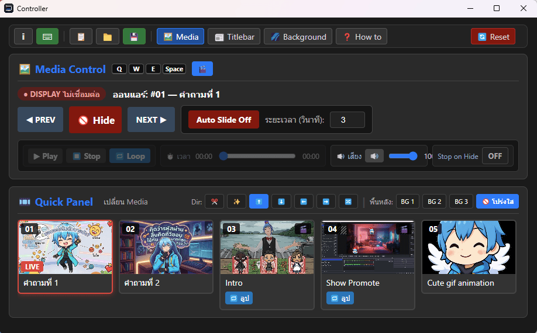
</p>

- **PREV / NEXT:** เปลี่ยนรายการก่อนหน้า/ถัดไป
- **Show / Hide:** แสดงหรือซ่อนภาพบนจอ
- **Auto Slide:** เปลี่ยนอัตโนมัติ ตั้งระยะเวลาเป็นวินาทีได้ นับเวลาที่ตัวโปรแกรม จึงยังทำงานแม้ปิด Controller
- **ป้าย "ออนแอร์":** บอกว่าตอนนี้รายการไหนกำลังขึ้นจอ
- **🎬 Video Controller** (กดปุ่มเพื่อเปิด/ปิด): ปุ่ม **Play / Stop / Loop**, แถบเวลา, แถบ**เสียง** (ปรับระดับและปิดเสียง), **หยุดเมื่อซ่อน**
- **แผงปรับสด 📷 / 🖥:** ขึ้นมาเมื่อสไลด์กล้อง/จับภาพออนแอร์
- **Quick Panel:** กดการ์ดเพื่อข้ามไปรายการนั้นได้เลย การ์ดที่กำลังขึ้นจอจะมีป้าย **LIVE** การ์ดวิดีโอมีไอคอน 🎬 และปุ่ม **ลูป** ส่วนการ์ด OBS แบบ Toggle จะแสดงสถานะจริง
- **Dir:** เอฟเฟกต์ตอนเปลี่ยนภาพ ได้แก่ ✂️ Cut (ทันที) · ✨ Fade · ⬆️⬇️⬅️➡️ Slide 4 ทิศ · 🔀 สุ่ม
- **พื้นหลัง BG 1 / 2 / 3 / โปร่งใส:** สลับฉากหลังหลังภาพ (ตั้งค่าไฟล์ใน Setup Media)

### Title Bar Control

<p align="center">
  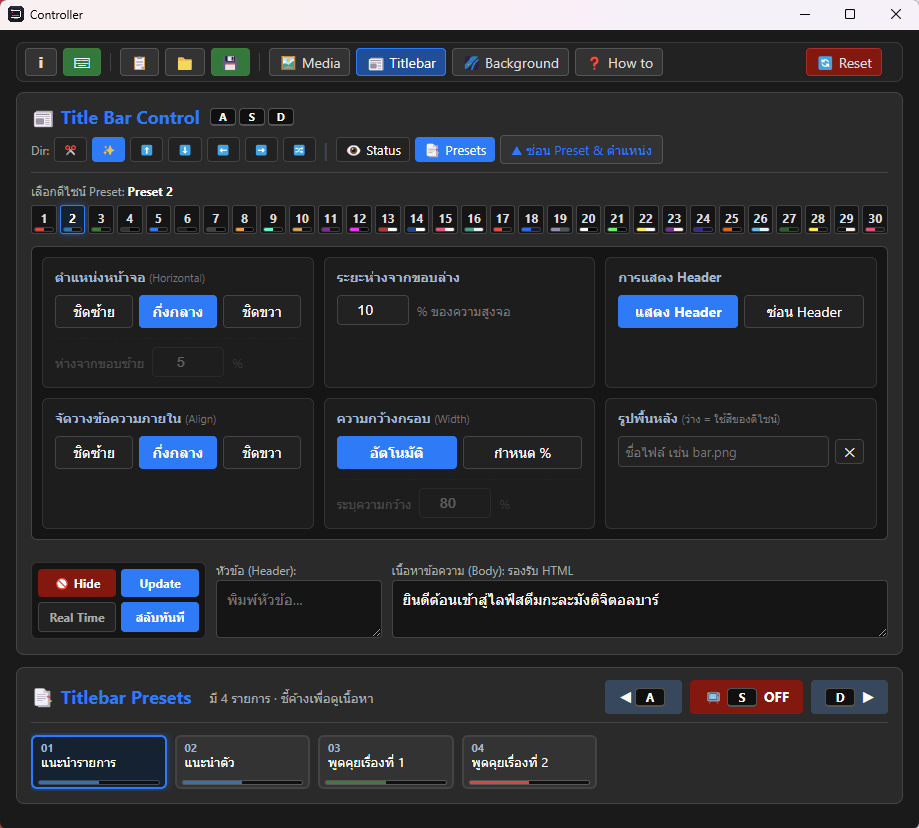
</p>

1. **เลือกดีไซน์ (1–30):** กดตัวเลขเพื่อเลือก
2. **ตั้งค่าตำแหน่งและรูปแบบ** (กดเพื่อพับเก็บได้): ตำแหน่งหน้าจอ · ระยะห่างจากขอบล่าง · แสดง/ซ่อน Header · จัดวางข้อความ · ความกว้างกรอบ (อัตโนมัติ/กำหนด %) · รูปพื้นหลัง
3. **พิมพ์ข้อความ:** ช่อง **หัวข้อ (Header)** และ **เนื้อหา (Body, รองรับ HTML)**
4. **ปุ่มสั่งงาน**
   - **Show / Hide:** ขึ้นหรือซ่อน Title Bar บนจอ (คีย์ลัด `S`)
   - **Update:** ส่งข้อความที่แก้ไขขึ้นจอ
   - **Real Time:** พิมพ์แล้วขึ้นจอทันทีโดยไม่ต้องกด Update
   - **สลับทันที:** เลือก Preset จากรายการแล้วขึ้นจอทันที
5. **Dir:** เอฟเฟกต์ตอนเปิด/ปิด/สลับ Title Bar
6. **Status:** เปิด/ปิดกล่องสถานะบนจอ
7. **Titlebar Presets (ด้านล่าง):** กดการ์ดเพื่อเลือก ใช้ **A / S / D** เพื่อเลื่อนก่อนหน้า/เปิดปิด/ถัดไป

### Background Control

<p align="center">
  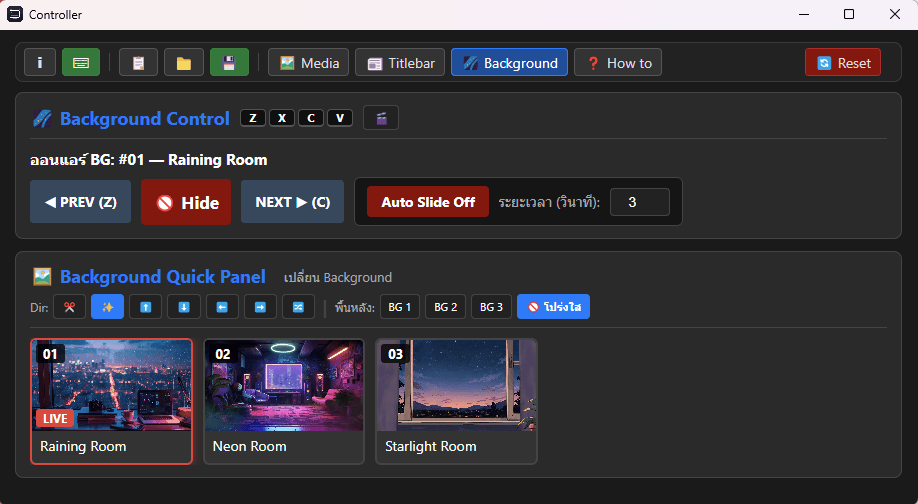
</p>

ใช้งานคล้าย Media Control แต่ควบคุมที่หน้าต่าง **OBS Background**: **PREV / Hide / NEXT**, **Auto Slide**, Quick Panel, Dir และ BG 1–3 / โปร่งใส รวมถึง Video Controller (🎬) สำหรับพื้นหลังที่เป็นวิดีโอ

### 🎬 OBS Scenes

ขึ้นมาเมื่อ SlideMang เชื่อมต่อ OBS แล้ว

- กดปุ่มเพื่อเปลี่ยน Scene ใน OBS โดยใช้ Transition ของปุ่มนั้น
- ปุ่มของ Scene ที่ออนแอร์จะไฮไลต์ และตามการเปลี่ยนที่ทำจากใน OBS เองด้วย
- **🔀 Transition** แสดง Transition บนแต่ละปุ่ม
- ภาพตัวอย่าง Scene จาก OBS: อัปเดตทุก 5 / 15 / 30 วินาที / 1 นาที, เฉพาะที่ออนแอร์, กดอัปเดตเอง (**🔄 อัปเดต**) หรือปิด

---

## คีย์ลัด

เปิดใช้โดยกดสวิตช์ ⌨ ในแถบเมนูของ Controller คีย์ลัดใช้ **รหัสปุ่มจริง** จึงใช้ได้แม้แป้นพิมพ์เป็นภาษาไทย และ **ไม่ทำงานขณะกำลังพิมพ์ในช่องข้อความ**

| กลุ่ม | ปุ่ม | หน้าที่ |
|---|---|---|
| **Media** | `Q` | รายการก่อนหน้า |
| | `W` | เปิด/ปิดภาพ (Show/Hide) |
| | `E` | รายการถัดไป |
| | `Space` | เล่น/หยุดวิดีโอ |
| **Titlebar** | `A` | Titlebar ก่อนหน้า |
| | `S` | เปิด/ปิด Titlebar |
| | `D` | Titlebar ถัดไป |
| **Background** | `Z` | Background ก่อนหน้า |
| | `X` | เปิด/ปิด Background |
| | `C` | Background ถัดไป |
| | `V` | เล่น/หยุดวิดีโอพื้นหลัง |
| **Setup Media** | `Ctrl+S` | บันทึก |

---

## ไฟล์ข้อมูล (config.json / session.json / settings.json)

ทุกอย่างเก็บในโฟลเดอร์ `data` และ **บันทึกอัตโนมัติ** ไม่ต้องเลือกไฟล์มาบันทึกทับเองแล้ว

| ไฟล์ | เก็บอะไร | บันทึกจากที่ไหน |
|---|---|---|
| **`config.json`** | รายการ Media / Background, Titlebar Presets, ปุ่ม OBS Scene, พื้นหลังด่วน, ตั้งค่าทั่วไป | **Setup Media** → 💾 บันทึก (สำรอง: `config.json.bak`) |
| **`session.json`** | สถานะสดของ Controller: รายการปัจจุบัน แสดง/ซ่อน ข้อความ Titlebar เอฟเฟกต์ Dir, Auto Slide, เสียง ฯลฯ | บันทึกอัตโนมัติ ใช้ร่วมกันทุก Controller |
| **`settings.json`** | ตำแหน่ง/ขนาดหน้าต่าง ภาษา พอร์ตและรหัสเซิร์ฟเวอร์ การเชื่อมต่อ OBS (รหัสผ่าน OBS เก็บที่นี่) | Launcher / Setup Media (โปรแกรมจัดการเอง) |

- **ปุ่ม 📁 / 💾 ใน Controller** ตอนนี้คือนำเข้า / ส่งออกสถานะเป็นไฟล์ `.json` ใช้เก็บหลายชุดสำหรับไลฟ์คนละแบบได้
- **ย้ายเครื่อง / แบ่งปันให้คนอื่น:** ก๊อปทั้งโฟลเดอร์ SlideMang (`SlideMang.exe` + `data/` + `media/`) ถ้าไม่อยากให้รหัสผ่านติดไปด้วย ให้ลบ `data/settings.json` ก่อน
- **สำรองข้อมูล:** ก่อนแก้ไขครั้งใหญ่ ให้คัดลอกโฟลเดอร์ `data` เก็บไว้ ถ้า `settings.json` เสีย โปรแกรมจะสำรองไว้เป็น `settings.json.broken` และเริ่มด้วยค่าเริ่มต้นให้อัตโนมัติ

---

## อัปเกรดจาก v2

- v3 ใช้ไฟล์ข้อมูลชุดใหม่: `data/config.json` และ `data/session.json` แทน `media-config.js` และ `save.json`
- วาง `SlideMang.exe` (v3) ใน **โฟลเดอร์ใหม่** ก๊อปโฟลเดอร์ `media` เดิมมาไว้ข้างกัน แล้วตั้งรายการใหม่ใน Setup Media (ใช้ **📥 เพิ่มไฟล์…** หรือลากไฟล์มาวางจะเร็วมาก)
- ตอนนี้มี `.exe` ตัวเดียวสำหรับทุกภาษา ไม่ต้องแยกโหลดตัว EN / TH แล้ว

---

## ปัญหาที่พบบ่อย

<details>
<summary><b>ภาพ/วิดีโอไม่ขึ้นบนจอ (ในรายการมีชื่อ แต่จอว่าง)</b></summary>

1. ดูว่ามีเครื่องหมาย ⚠ ข้างชื่อไฟล์ใน Setup Media หรือไม่ ถ้ามีแปลว่าไฟล์ไม่อยู่ใน `media/` ให้กด 📁 เลือกไฟล์ใหม่ โปรแกรมจะก๊อปเข้าไปให้
2. กด **💾 บันทึก** ใน Setup Media แล้วหรือยัง
3. กด **🔄 รีเฟรช OBS** ใน Launcher หรือ Controller
</details>

<details>
<summary><b>ป้ายขึ้นว่า "DISPLAY ไม่เชื่อมต่อ"</b></summary>

หน้าต่างแสดงผลยังไม่ได้เปิด เปิด **OBS Titlebar / OBS Slides / OBS Background** จาก Launcher (หรือเปิด URL ของแต่ละหน้าใน OBS Browser Source) แล้วป้ายจะเปลี่ยนเป็นเชื่อมต่อ
</details>

<details>
<summary><b>Browser Source ใน OBS ไม่อัปเดต / ยังเป็นของเก่า</b></summary>

กด **🔄 รีเฟรช OBS** ใน Launcher หรือ Controller ปุ่มนี้รีโหลด Browser Source ให้ด้วย
</details>

<details>
<summary><b>สไลด์กล้องเป็นจอดำ / ขึ้นว่า "กล้องถูกใช้งานอยู่"</b></summary>

มีโปรแกรมอื่น (ส่วนใหญ่คือ OBS) ใช้กล้องอยู่ กล้องหนึ่งตัวใช้ได้ทีละโปรแกรม ให้เอากล้องออกจาก OBS หรือเปลี่ยนไปใช้สไลด์แบบ **📡 OBS Source** เพื่อให้กล้องอยู่ใน OBS ตามเดิม
</details>

<details>
<summary><b>กล้อง / จับภาพหน้าจอ ไม่ขึ้นใน Browser Source หรือในเครื่องอื่น</b></summary>

ตรวจว่าเปิด **📡 ส่งภาพสไลด์กล้อง / จับภาพหน้าจอ ไปยัง Browser Source ของ OBS และจอที่เปิดผ่าน Network (WebRTC)** ไว้ที่ Setup Media → ทั่วไป ระบบส่งภาพจะเริ่มเมื่อสไลด์ออนแอร์ อาจใช้เวลาสักครู่
</details>

<details>
<summary><b>จับภาพหน้าต่างแล้วส่วนที่ควรโปร่งใสเป็นสีดำ</b></summary>

ตั้ง **พื้นหลังโปร่งใส → ส่วนสีดำ → โปร่งใส** ที่สไลด์นั้น ถ้ายังมีขอบดำเหลือ ให้เพิ่ม **ระดับการลบ %**
</details>

<details>
<summary><b>เชื่อมต่อ OBS ไม่ได้ (OBS Source / OBS Scenes)</b></summary>

1. OBS ต้องเป็นเวอร์ชัน 28 ขึ้นไป และเปิดอยู่
2. ใน OBS: **Tools → WebSocket Server Settings** → ต้องติ๊ก **Enable WebSocket server**
3. คัดลอกพอร์ตและรหัสผ่านจาก **Show Connect Info** มาใส่ที่ Setup Media → ทั่วไป → 📡 เชื่อมต่อ OBS แล้วกด **🔌 เชื่อมต่อ & ทดสอบ**
</details>

<details>
<summary><b>OBS จับภาพแล้วพื้นหลังเป็นสีดำ ไม่โปร่งใส</b></summary>

ลองตั้ง Capture Method ของ Window Capture เป็น **Windows 10 (1903 and up)** ถ้ายังไม่ได้ ให้ปิด "โปร่งใส" ใน Launcher แล้วใช้ Chroma Key สีเขียว หรือเปลี่ยนไปใช้ **Browser Source** (ดู[ตั้งค่าใช้กับ OBS](#ตั้งค่าใช้กับ-obs))
</details>

<details>
<summary><b>มือถือ/เครื่องอื่นเข้า Controller ไม่ได้</b></summary>

1. ติ๊ก **อนุญาตเครื่องอื่นในเครือข่าย** แล้วหรือยัง
2. มือถือและคอมพิวเตอร์อยู่ใน Wi-Fi/เครือข่ายเดียวกันหรือไม่
3. Firewall ของ Windows อนุญาตโปรแกรมแล้วหรือไม่ (เลือก Private network)
4. ใช้ URL ที่เป็น `192.168.x.x` (ไม่ใช่ `127.0.0.1` ซึ่งหมายถึงเครื่องนั้นเอง) และใส่รหัสท้าย URL ตามที่ Launcher สร้างให้
</details>

<details>
<summary><b>พอร์ตถูกใช้อยู่ / เปิดโปรแกรมซ้อนสองครั้ง</b></summary>

โปรแกรมเปิดได้ครั้งละหนึ่งหน้าต่างหลัก ถ้าเปิดซ้ำ ตัวใหม่จะปิดเอง ถ้าพอร์ต `8765` ถูกโปรแกรมอื่นใช้ โปรแกรมจะลองพอร์ตถัดไปให้ หรือเปลี่ยนพอร์ตเองในส่วน **เซิร์ฟเวอร์**
</details>

<details>
<summary><b>ติดตั้ง Electron ไม่ผ่าน (ERR_REQUIRE_ESM)</b></summary>

Node.js เก่าเกินไป ให้อัปเดตเป็นเวอร์ชัน **22 LTS ขึ้นไป** แล้วลบโฟลเดอร์ `node_modules` กับไฟล์ `package-lock.json` และสั่ง `npm install` ใหม่
</details>

<details>
<summary><b>ดูข้อผิดพลาดของหน้าต่าง</b></summary>

กด **F12** ในหน้าต่างนั้นเพื่อเปิดเครื่องมือนักพัฒนา แล้วดูแท็บ Console ส่งข้อความผิดพลาดมาในหน้า [Issues](https://github.com/KaLaMangVT/SlideMang/issues) ได้
</details>

---

## 💖 Support the Project

โปรแกรมฟรีสำหรับสตีมเมอร์ วีทูปเบอร์ ถ้าถูกใจค่อยกลับมาปาเงินใส่ก็ยังไม่สาย:

- ▶️ [Youtube] [https://www.youtube.com/@KaLaMangVT](https://www.youtube.com/@KaLaMangVT)

- ☕ [SocialBuzz] [https://sociabuzz.com/kalamangvt/donate](https://sociabuzz.com/kalamangvt/donate)

- 💳 [Ko-fi] [https://ko-fi.com/kalamangvt](https://ko-fi.com/kalamangvt)

- 🧧 [EasyDonate] [https://ezdn.app/kalamangvt](https://ezdn.app/kalamangvt)

---

## License

เผยแพร่ภายใต้สัญญาอนุญาต [GPL-3.0](LICENSE)
